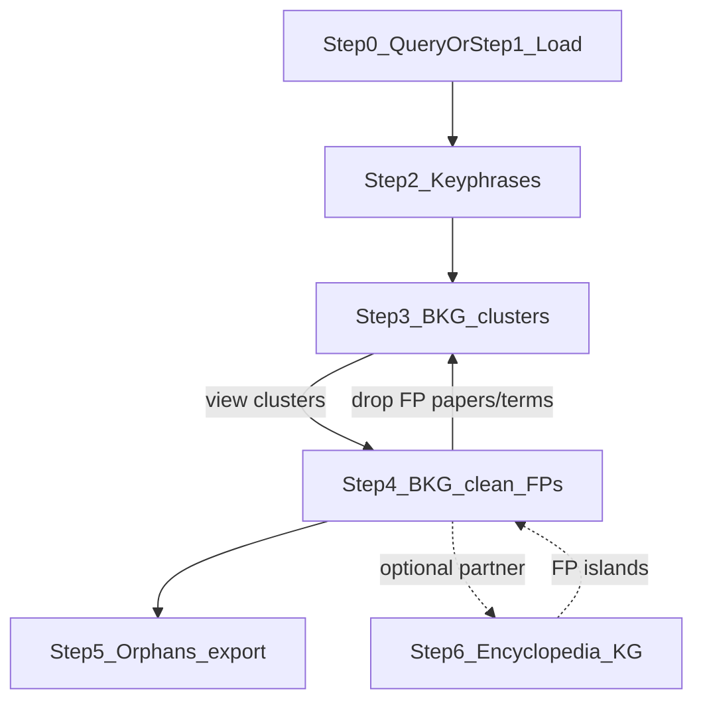

# Paper–term clusters for corpus filtering

**Date:** 2026-10-28 (updated 2026-11-02)  
**Status:** Steps **0–3** implemented (library + tests + examples + Streamlit); Steps 4–6 planned (KG cleaning loops; **no Step 7**)  
**Progress note:** [cluster_review_steps_0_3_progress.md](cluster_review_steps_0_3_progress.md)  
**Pipeline CLI:** [pipeline.md](pipeline.md) (`pipeline --workdir … --query … --target clusters`)  
**Orchestration (Make / doit decision):** [pipeline_make_doit.md](pipeline_make_doit.md)  
**UI:** Streamlit (`apps/cluster_review/app.py`)  
**Terms:** **corpus TF-IDF** (default) for the filter loop — not KBIR; YAKE optional fallback; default **`n=3`**; body-only indexing  
**Branch:** `pmr202610`

---

## 1. Purpose

Build an interactive path from **query → corpus → phrases → bipartite paper–term knowledge graph (BKG) → clusters**, then let a curator **clean false-positive papers and terms using graph feedback loops** (BKG clusters + optional Wikipedia/Wikidata encyclopedia KG) until the retained set is fit for encyclopedia / local LLM work.

All include/exclude decisions remain **human**. The system proposes clusters and ranks; it does not auto-delete. There is **no separate Step 7** — FP removal is the cleaning loops on Steps 3→4 (and optionally 4↔6).

---

## 2. Terminology

| Term | Meaning |
|------|---------|
| **BKG** | Bipartite knowledge graph: papers (PMCs) ↔ keyphrases/terms, with edge weights from phrase scores |
| **Cluster** | Densely co-linked subgroup of papers and terms in the BKG (Louvain / Leiden, etc.) |
| **Theme** | Optional UI label for a cluster (from top terms) |
| **Orphan** | Paper (or term) in a trivial / singleton component — review or remove individually |
| **Cleaning loop** | Curator weeds FP **papers** and/or FP **terms** using the graph, then optionally recomputes clusters |
| **Encyclopedia KG** | Wikipedia entries for phrases, related via bibliography / Wikimedia / Wikidata proximity — islands often mark FPs |
| **Remove cluster** | Curator rejects that cluster; member papers marked `exclude` (unless overridden); demote cluster-only terms |
| **Propagate** | Apply a cluster-level Keep/Remove decision to member papers |

Former docs used “community”; **cluster** is the preferred term everywhere in this design.

---

## 3. Planned end-to-end product (with KG cleaning loops)

One Streamlit app (plus thin library helpers). **Steps 0–6 only** (Step 7 removed — cleaning is feedback, not a final bolt-on).

### 3.1 New diagram — BKG / encyclopedia cleaning loops (2026-11-02)

ASCII + Mermaid live **here in this section** (not a separate image file). The poster sketch JPG was **not** overwritten.

```text
Step 0: Query → download → (optional) BAGIT
   or
Step 1: Load existing BAGIT
                    │
                    ▼
Step 2: Keyphrases (TF-IDF / uppercase phrases)
                    │
                    ▼
Step 3: Bipartite KG (BKG)  paper ↔ term  →  clusters / orphans
                    │
         ┌──────────┴──────────┐
         │  cleaning loop      │  weed FP papers + FP terms
         │  (recompute BKG)    │
         ▼                     │
Step 4: BKG-guided Keep/Remove ┘
                    │
                    ├────────────── optional partner ──────────────┐
                    ▼                                              ▼
Step 5: Orphans + curated export              Step 6: Encyclopedia KG
        (review table snapshot)               (Wikipedia / Wikidata)
                                              islands of FPs feed back
                                              into Step 4 cleaning
```



### 3.2 Preserved earlier linear diagram (pre–cleaning-loops)

Kept for history — do not delete; the §3.1 diagram supersedes it for current design.

```text
Step 0: Query → download → (optional) BAGIT create
   or
Step 1: Load existing BAGIT
                    │
                    ▼
         TF-IDF phrases  →  Bipartite graph  →  Clusters
                                                              │
                    ┌─────────────────────────────────────────┘
                    ▼
         Iterative UI: inspect / remove clusters + orphans
                    │
                    ▼
         Updated review table (include / exclude)
                    │
                    ▼
         (Later, out of scope for v1 filter) encyclopedia / KBIR on Keep set
```

**Poster layout sketch (unchanged):** [aukget-poster-a0-sketch.jpg](aukget-poster-a0-sketch.jpg)

**Step 0–3 code:** `semantic_corpus/cluster_review/step{0,1,2,3}.py`; tests `tests/test_cluster_review_step{0,1,2,3}.py`; examples under `examples/cluster_review/`; app `apps/cluster_review/app.py`.

---

## 4. Example corpus for users (~50 papers)

**Default demo corpus:** `ocean_heatwaves_2026` (or `climate_anxiety_2026` as fallback).

| Property | Intent |
|----------|--------|
| Size | ~50 papers (query harvest scale already used in demos) |
| Source | Europe PMC open full text where available |
| Bundled for users | Pre-built query dir / fixtures under `tests/fixtures/ocean_heatwaves_2026/` or `temp/queries/…` so the UI can start **without** a live harvest |
| Live path | Optional: run a YAML query (limit 50) then continue into phrases → clusters |

Workshop mode should default to the **pre-built 50-paper bundle** so elapsed time is dominated by phrase extract + human review, not download flakiness.

**Live worked example (path contract for Steps 0–6):** see [§12 Worked example: AMOC AND India](#12-worked-example-amoc-and-india) — query `AMOC AND India`, limit 50 XML, single active corpus root `corpora/amoc_india_2026/`.

---

## 5. Pipeline stages (design)

### 5.1 Query → corpus (UI Step 0) or load BAGIT (UI Step 1)

- **Step 0:** Form/YAML: one or more repositories, query, limit 50, dates, formats xml (± pdf). Search + download via adapters; raw query dir + review table; **option to create BAGIT** under `corpora/`.  
- **Step 1:** Load an existing BAGIT (demo ~50-paper `ocean_heatwaves_2026` or user path). Workshops may start here and skip Step 0.

### 5.2 Phrases (corpus TF-IDF default)

- Input: title + abstract + XML body (capped; abstract-only OK if no body).  
- **Default:** corpus **TF-IDF** on **XML body only** (no front matter / title / abstract; no references or acknowledgments sections), plus **document-grounded uppercase phrases** (titlecase / acronyms).  
- **Fallback:** per-paper YAKE (`method="yake"`) — same text policy.  
- Hygiene: lowercase, English stopwords, editable stop lists under `cluster_review/lists/`.  
- Output: per-paper phrase list (JSON/CSV) used only for clustering.

KBIR remains **out of this loop** (optional later on Keep papers for encyclopedia).

### 5.3 Bipartite knowledge graph (BKG) — Step 3

- Build **BKG**: paper (PMC) ↔ term edges (weights from TF-IDF / YAKE score).  
- Cluster detection (Louvain / Leiden).  
- Emit: cluster id, member papers, member terms, orphan papers/terms.  
- Expect **multiple** FP islands (methods, author citations, off-topic domains) — not a single TP/FP split.  
- The BKG is the primary structure for **weeding FP papers and FP terms** in Step 4.

### 5.4 Cleaning loops (Steps 4 ↔ 3, optional 4 ↔ 6)

**BKG loop (required path):**

1. Show clusters (size, top terms, sample titles) from the BKG.  
2. Curator **Remove** / **Keep** / **Inspect** — drop FP **papers** and/or demote FP **terms**.  
3. **Recompute** clusters on the remaining Keep set (feedback into Step 3).  
4. Repeat until themes look topical; then clear **orphans** (Step 5) and export.

**Encyclopedia KG loop (optional partner to Step 4):**

- Build Wikipedia / Wikidata neighbourhoods for retained phrases (Step 6).  
- Disconnected **islands** and off-topic neighbourhoods often mark FP terms (or papers that only hitchhiked via those terms).  
- Feed those signals back into Step 4 Keep/Remove — Step 6 does **not** replace Step 4; it is an optional partner.  
- There is **no Step 7**; FP removal is these loops, not a final separate stage.

---

## 6. Streamlit UI outline (planned)

### Screen A — Start

- Choose: **Demo corpus (50 papers)** / path to corpus / optional “run query (limit 50)”.  
- Show query text used for the demo.  
- Buttons: **Load corpus**, **Extract phrases**, **Build clusters**.  
- Progress + elapsed timers per stage.

### Screen B — Cluster board (main loop)

For each cluster card:

| Element | Content |
|---------|---------|
| Theme | Auto from top 3–5 YAKE terms |
| Size | *N* papers, *M* terms |
| Samples | Titles (+ abstract expand) |
| Actions | **Keep** · **Remove cluster** · **Inspect** · **Unsure** |

Global: remaining paper count, **Recompute clusters**, **Save**, **Finish**.

### Screen C — Cluster inspect

- Member papers with per-paper override (keep one paper while removing rest).  
- Member terms; option “demote these terms if cluster removed”.

### Screen D — Orphans

- List orphan papers (and optionally orphan terms).  
- **Remove** / **Keep** individually or small multi-select.  
- Orphans never disappear silently when a large cluster is removed.

### Screen E — Summary

- Include / exclude / still review counts.  
- Log of removed cluster themes.  
- Download updated `review_table.json` / CSV.  
- Note: precise KE (e.g. KBIR) is a **separate later step** on Keep only.

---

## 7. Estimated elapsed time

Assumptions: laptop/M1-class CPU, demo **pre-built 50-paper** corpus, TF-IDF on title+abstract+XML body (not full PDF OCR), Streamlit local, one curator familiar with the topic.

### 7.1 Machine time (approximate)

| Stage | Estimate (50 papers) | Notes |
|-------|----------------------|--------|
| Load pre-built corpus + review table | **&lt; 5 s** | Disk / JSON |
| Live query + download (optional, not demo default) | **5–20 min** | Network, XML; PDF flaky (see EPMC PDF note) |
| Corpus TF-IDF (title+abstract+XML body) | **~5–30 s** | One fit over the bag; then cache |
| YAKE fallback (optional) | **1–3 min** | ~1–4 s/paper on body text |
| Build bipartite graph + cluster | **&lt; 10–30 s** | NetworkX/igraph scale is tiny at n=50 |
| Streamlit recompute after a removal | **&lt; 5–15 s** | If phrases cached |
| **Machine total (demo path)** | **&lt; 1 min** before human review | TF-IDF + load |

### 7.2 Human time (approximate)

| Activity | Estimate |
|----------|----------|
| First pass: scan ~5–15 clusters, remove obvious FP themes | **15–30 min** |
| Orphan pass | **5–15 min** |
| Optional second clustering + cleanup | **10–20 min** |
| **Human total** | **~30–60 min** for a careful first curation |

### 7.3 End-to-end workshop slot

| Mode | Wall clock |
|------|------------|
| Demo corpus + YAKE + one curation pass | **~45–75 min** |
| Including live harvest of 50 papers | **~1–2 h** (network-dependent) |
| Contrast: KBIR on 50 papers | **~4 h+** machine alone — why it stays out of v1 |

---

## 8. UI build plan — one app, stepped delivery

**Principle:** Ship **one** Streamlit application from day one (`apps/cluster_review/app.py` or `scripts/cluster_review_app.py`). Each step unlocks the next stage in the **same** sidebar/navigation shell. Do not build separate throwaway UIs.

### 8.1 Persistent shell (all steps)

Present from Step 0 onward:

| UI chrome | Role |
|-----------|------|
| Title | Cluster review — semantic_corpus |
| Sidebar: stage list | **Query / BAGIT** → **Load** → Phrases → BKG clusters → BKG clean → Orphans/export → Encyclopedia KG |
| Sidebar: entry mode | **Create from query** (Step 0) **or** **Load existing BAGIT** (Step 1) |
| Sidebar: status counts | Papers / phrases ready? / clusters / orphans / include·exclude |
| Main panel | Content for the **active** stage only |
| Footer | Elapsed timers + corpus path / review table path |

Disabled stages show as locked until prerequisites are met (e.g. Phrases locked until a corpus is active; Clusters locked until phrases exist).

**Entry rule:** the user picks **either** Step 0 **or** Step 1 to obtain an active BAGIT corpus; Steps 2+ are identical either way.

### 8.2 Steps

File/directory layout for a full run is spelled out in [§12](#12-worked-example-amoc-and-india).

| Step | Name | What the user does | Artifacts |
|------|------|--------------------|-----------|
| **0** | **Query → raw / BAGIT corpus** | Search one or more repositories with a query; download; optionally create a **BAGIT** corpus | **Implemented** — query dir + BAGIT |
| **1** | **Load existing BAGIT** | Open an existing BAGIT corpus (e.g. demo `ocean_heatwaves_2026`) and browse papers | **Implemented** — corpus `review/` |
| **2** | **Phrases (TF-IDF)** | Extract / cache corpus TF-IDF phrases (YAKE optional) | **Implemented** — `<corpus>/phrases/` |
| **3** | **BKG + clusters (view)** | Build bipartite paper↔term KG; inspect cluster themes (read-only) | **Implemented** — `<corpus>/clusters/` |
| **4** | **BKG clean (FP papers/terms)** | Keep / Remove / Inspect using the BKG; demote FP terms; recompute loop → 3 | **Planned** — `review/` + `clusters/decisions.json` |
| **5** | **Orphans + export** | Keep / Remove orphans; curated review snapshot | **Planned** — `review/` + `export/` |
| **6** | **Encyclopedia KG** *(optional partner to 4)* | Wikipedia / Wikidata neighbourhoods for phrases; FP islands feed Step 4 | **Planned** — `<corpus>/encyclopedia/` + KG view |

#### Step 0 — Search repositories and create corpus (query path)

- App shell runs; **Query / create** stage active.  
- Choose repository(ies) (e.g. Europe PMC; later multi-select as adapters allow).  
- Enter query, limit (default 50), date bounds, formats (xml ± pdf).  
- **Search** → show hit preview; **Download** into a working query dir (raw corpus).  
- Option: **Create BAGIT corpus** from the download (name + output under `corpora/`).  
- Initialize / refresh review table (statuses `review`).  
- **Done when:** curator has a new BAGIT (or at least a raw query dir ready to bag) from a live query, usable as the active corpus for Steps 2+.

#### Step 1 — Load an existing BAGIT corpus ✅

- **Load corpus** stage: pick path or demo preset (`ocean_heatwaves_2026`, `step0_live_demo`, …).  
- Validate BAGIT layout (incl. nested `data/data`); load paper list + review table (reuse existing or build).  
- Show **Corpus** table (paper id, title, status).  
- **Update BAGIT with additional files (PDF)** — available here and from the sidebar at any later stage (`update_bagit_formats`); does not re-run the query.  
- **Done when:** curator can browse the loaded BAGIT with no phrases/graph yet.  
- Workshops may **skip Step 0** and start here.  
- **Code:** `semantic_corpus/cluster_review/step1.py`, `update_corpus.py`; tests `tests/test_cluster_review_step1.py`, `tests/test_cluster_review_update_corpus.py`; examples `step1_load_bagit.py`, `update_corpus_files.py`.

#### Step 2 — Phrases (TF-IDF) inside the same app ✅

- **Phrases** stage: **Extract phrases** (default corpus TF-IDF on **XML body only**, **`n=3`**); optional YAKE; cache beside the corpus (`<corpus>/phrases/{paper_id}.json` + `index.json`).  
- Phrase objects include `phrase` + `display` (usual capitalization) + `score`.  
- Progress bar + per-paper timing; **Use cached phrases** if present.  
- Main panel: phrases for a selected paper; corpus-level phrase count.  
- **Done when:** active corpus has cached phrases without leaving the app.  
- **Code:** `semantic_corpus/cluster_review/step2.py`, `tests/test_cluster_review_step2.py`, `examples/cluster_review/step2_extract_yake.py`.

#### Step 3 — BKG + clusters (read-only view) ✅

- **BKG** stage: **Build / refresh** bipartite paper↔term knowledge graph + Louvain clusters (greedy modularity fallback).  
- Cluster cards (theme, size, top terms, member papers) — **view only** until Step 4.  
- Orphans listed but not actionable yet.  
- **Done when:** curator sees a stable partition and can spot likely FP themes (papers **and** terms).  
- **Code:** `semantic_corpus/cluster_review/step3.py`, `tests/test_cluster_review_step3.py`, `examples/cluster_review/step3_build_clusters.py`.  
- **Paths:** see [§12.6](#126-step-3--clusters-view-).

#### Step 4 — BKG clean: FP papers and FP terms *[planned]*

- On each cluster card: **Keep** / **Remove cluster** / **Unsure** / **Inspect**.  
- Inspect: member **papers** (per-paper override) and member **terms** (demote / drop FP phrases).  
- **Cleaning loop:** Save → optional **Recompute BKG clusters** (back to Step 3 view) → repeat.  
- Provisional labels in session; **Save** writes review table + term denylist / decisions.  
- **Done when:** FP papers and FP terms can be removed and include/exclude persisted.  
- **Paths:** see [§12.7](#127-step-4--bkg-clean-fp-papersterms-planned).

#### Step 5 — Orphans + curated export *[planned]*

- **Orphans** stage: Keep / Remove individuals or multi-select (no silent drops).  
- Summary counts + removal log; download curated review table under `export/`.  
- **Done when:** orphans cleared/parked and a take-home snapshot exists.  
- **Paths:** see [§12.8](#128-step-5--orphans--export-planned).

#### Step 6 — Encyclopedia KG *(optional partner to Step 4)* *[planned]*

- Resolve Wikipedia entries for retained phrases; embed neighbourhood via Wikidata / Wikimedia proximity.  
- Visualise **islands** of loosely connected or off-topic entries — often FP terms (or papers tied only through them).  
- Curator may send island hits back into **Step 4** cleaning; Step 6 never auto-deletes.  
- **Not** a mandatory stage; skip when BKG cleaning alone is enough.  
- **No Step 7** — do not add a separate “remove FPs” finale.  
- **Paths:** see [§12.9](#129-step-6--encyclopedia-kg-optional-partner-planned).

### 8.3 Backend modules behind the UI (build alongside steps)

| Step | Library work (no second UI) |
|------|-----------------------------|
| 0 | Multi-repo search + download; BAGIT create from query output; review table init |
| 1 | BAGIT / review-table loader (demo + arbitrary path); update PDFs |
| 2 | TF-IDF / YAKE phrase cache I/O |
| 3 | BKG (bipartite graph) + cluster + orphan detection |
| 4 | Label model: FP papers + FP terms; merge into `review_status`; recompute hook |
| 5 | Orphan decisions + export snapshot |
| 6 | Encyclopedia / Wikidata neighbourhood graph (optional; feeds Step 4) |

### 8.4 What not to do

- Do not create a new Streamlit app per step.  
- Do not add KBIR to the BKG filter loop (encyclopedia KG is Step 6, optional).  
- Do not force every user through Step 0 — **Load BAGIT (Step 1)** must work alone for demos.  
- Do not treat raw query-dir-only as the long-term store when the user asked for BAGIT — offer explicit **Create BAGIT**.  
- Do not add a **Step 7**; FP cleaning is the BKG / encyclopedia loops.

### 8.5 Suggested coding order vs workshop value

| After completing | Demo you can give |
|------------------|-------------------|
| Step 0 | “Search EPMC (or more repos), download, create BAGIT” |
| Step 1 | “Open the existing 50-paper ocean heatwaves BAGIT” |
| Step 2 | “Keyphrases in ~2–5 minutes” |
| Step 3 | “BKG clusters — candidate FP themes” |
| Step 4 | “Weed FP papers and FP terms; recompute BKG” |
| Step 5 | “Orphans + take-home review table” |
| Step 6 | “Optional: encyclopedia KG islands → back to Step 4” |

---

## 9. Implementation sketch (supporting code)

Ordered library deliverables aligned with §8 — application UI is the Streamlit shell above:

1. Query → download → **BAGIT create** (Step 0) using existing repository + corpus managers.  
2. BAGIT loader for demo + path pickers (Step 1).  
3. Phrase batch helper → `phrases/*.json` beside corpus (Step 2).  
4. BKG + cluster module → `clusters.json` (+ orphans) (Step 3).  
5. Wire Steps 4–5 cleaning loop + export; Step 6 encyclopedia KG as optional partner to 4.  
6. Short tutorial: create-or-load, then filter with BKG cleaning loops.

Layout: `apps/cluster_review/` + `semantic_corpus/cluster_review/`.

Dependencies: `yake` (optional), `streamlit`, `networkx` (and/or `igraph` + Leiden); encyclopedia KG may add Wikidata clients later.

---

## 10. Success criteria (pilot)

1. User can **create** a BAGIT corpus from a query (Step 0) **or** **load** an existing BAGIT (Step 1), including the ~50-paper demo.  
2. Phrases + first BKG cluster view ready in a few minutes once a corpus is active (cached thereafter).  
3. User can **weed FP papers and FP terms** via the BKG (Step 4 ↔ 3) and **clear orphans** (Step 5); review table updates on Save.  
4. No silent drops; Unsure/orphans remain visible.  
5. No KBIR inside the BKG filter loop; encyclopedia KG (Step 6) is optional and partners Step 4.  
6. One Streamlit app covers Steps **0–6** only (no Step 7); Step 0 and Step 1 are alternative entry points.

---

## 11. Out of scope for v1 filter UI

- KBIR / `txt2phrases` transformer extraction inside the loop  
- Multi-user auth  
- Full-corpus force graph as primary UI  
- Automatic remove without confirmation  
- Encyclopedia generation (follows Keep set in a later phase)

---

## 12. Worked example: AMOC AND India

End-to-end **path contract** for all seven UI steps (0–6). This is the authoritative layout for a live harvest + curation run. Use it to avoid Streamlit “directory crossover” (session still pointing at a previous query or demo).

### 12.1 Path contract

| Role | Path |
|------|------|
| Query name | `amoc_india_2026` |
| Query string | `AMOC AND India` |
| Repository | `europe_pmc` |
| Formats / limit | `xml` only · **50** |
| Raw harvest (Step 0 only) | `temp/queries/amoc_india_2026/` |
| **Active corpus root (Steps 1–6)** | `corpora/amoc_india_2026/` |

| Step | Status |
|------|--------|
| 0–2 | **Implemented** (library + Streamlit) |
| 3–6 | **Planned** paths (contract for upcoming code) |

### 12.2 Active corpus root (anti-crossover)

Streamlit must pin one workspace for the whole run:

- Session `active_corpus.corpus_dir` = `corpora/amoc_india_2026` after Step 0 (with BAGIT) or Step 1.
- Derived directories are always under that root:
  - `<corpus_dir>/phrases`
  - `<corpus_dir>/clusters`
  - `<corpus_dir>/review`
  - `<corpus_dir>/export`
- Steps **2–6 never write** under `temp/queries/…` or under another demo in `corpora/`.
- The Step 0 query dir is **harvest only** (XML + initial search/review). It is not the YAKE/cluster workspace.
- `clear_all_caches` (Step 2) deletes only `<corpus_dir>/phrases/`.
- Rebuilds / recomputes only touch the active corpus tree.

```text
Step 0: temp/queries/amoc_india_2026  ──ingest──►  corpora/amoc_india_2026
                                                    │
Step 1: load / pin active corpus ─────────────────────┤
Step 2: phrases/ ─────────────────────────────────────┤
Step 3: clusters/  (BKG) ──► Step 4 clean ◄─┐         │
                         └── recompute loop ─┘         │
Step 5: orphans + export/ ─────────────────────────────┤
Step 6: encyclopedia/ KG (optional) ──► feedback to 4 ─┘
```

### 12.3 Step 0 — Query → download → BAGIT ✅

**CLI — full Steps 0–2 (recommended):**

```bash
# Default: query "AMOC AND India", limit 50, corpus corpora/amoc_india_2026/
python examples/cluster_review/run_steps_0_2.py

# Smoke test / resume
python examples/cluster_review/run_steps_0_2.py --limit 3
python examples/cluster_review/run_steps_0_2.py --from-step 1
```

**CLI — harvest only (preferred over pygetpapers):**

```bash
# Native
semantic_corpus download -q 'AMOC AND India' -r europe_pmc -l 50 -f xml \
  -o temp/queries/amoc_india_2026

# Or translate a pygetpapers-style line (quoting handled by the shell / shlex)
semantic_corpus --pygetpapers -q 'AMOC AND India' -k 50 \
  -o temp/queries/amoc_india_2026 -x
```

Europe PMC outages (HTTP 503 / `errCode`) raise a clear `RepositoryError` with a retry hint — not a `responseWrapper` KeyError.

**Operations**

1. Search Europe PMC for `AMOC AND India`, limit 50.  
2. Download up to 50 XML into the query dir.  
3. Write search results, provenance, and an initial review table under the query dir.  
4. Ingest into a new BAGIT corpus; update manifests.  
5. Set Streamlit `active_corpus.corpus_dir` to the BAGIT root.

**Creates / updates**

```text
temp/queries/amoc_india_2026/
  search_results.json
  query_run.json                    # provenance
  PMC........xml                    # up to 50
  PMC........xml
  ...
  review/
    review_table.json
    review_table.csv
    review_table.md
    review_table.html               # if exporter writes HTML
    ...

corpora/amoc_india_2026/            # ACTIVE CORPUS ROOT
  bagit.txt
  bag-info.txt
  manifest-sha256.txt               # updated after ingest
  data/
    documents/xml/
      europe_pmc_PMC........xml
      europe_pmc_PMC........xml
      ...                           # ≤50
    documents/pdf/                  # empty (xml-only run)
    documents/html/
    metadata/
      europe_pmc_PMC........_metadata.json
      europe_pmc_PMC........_metadata.json
      ...
    keyphrases/                     # bag layout; unused by YAKE step
    semantic/
    indices/
  analysis/
  provenance/
  relations/
```

**Does not yet create:** `corpora/amoc_india_2026/phrases/`, `clusters/`, corpus-level `review/` (may appear in Step 1), `export/`.

### 12.4 Step 1 — Load existing BAGIT ✅

**Operations**

1. Resolve `bagit.txt` under `corpora/amoc_india_2026`.  
2. List papers from `data/metadata/*_metadata.json`.  
3. Prefer an existing review table if present; else **build** and write under the corpus.  
4. Pin `active_corpus.corpus_dir = corpora/amoc_india_2026` (ignore other demos / prior searches).

**Creates / updates** (when review is missing under the corpus)

```text
corpora/amoc_india_2026/
  review/                           # NEW if not already here
    review_table.json               # statuses mostly "review"
    review_table.csv
    review_table.md
    ...
```

**Reads only:** bag layout + metadata + XML paths. No YAKE/cluster files yet.

### 12.5 Step 2 — Phrases (corpus TF-IDF, n=3) ✅

**Operations**

1. For each paper, build text from **title + abstract + XML body** (body capped, default 50k chars).  
2. **Default `method=tfidf`:** fit one corpus `TfidfVectorizer` (blended with local TF), then merge in **document-grounded uppercase phrases** (capitalized multiwords + repeated acronyms/place names from the paper text — not query seeds). Higher score = better.  
3. Optional `method=yake`: per-paper YAKE on the same text (lower score = better).  
4. Write cache beside the corpus; write `index.json` + CSV exports. Caches whose `params.method` does not match are ignored.  
5. `clear_all_caches` deletes this whole `phrases/` tree only (not BAGIT payload, not `review/`).

**Creates**

```text
corpora/amoc_india_2026/
  phrases/                          # NEW
    index.json
    phrases.csv                     # long form: paper_id, rank, phrase, score, channel
    phrases_summary.csv             # per-paper inspection: counts + top phrases
    phrases_terms.csv               # unique phrases: n_papers + per-channel scores
    europe_pmc_PMC........json
    europe_pmc_PMC........json
    ...                             # one file per paper (≤50)
```

**Per-paper JSON fields (typical):** `paper_id`, `phrases` (`[{phrase, display, score, channel}, …]`), `params` (`method`, `n`, `top`, `text_fields`, `phrase_schema`), `text_source`, `elapsed_s`.  
`phrase` is the lowercase match key; `display` is the usual capitalization recovered from the paper (e.g. `ISM`, `NegE`, `Indian Ocean`).  
`channel` is `uppercase` | `tfidf` | `yake` (set at extract; schema 4+). `uppercase` = capitalization/titlecase/acronym channel (not “correct”). TF-IDF mode merges two incompatible score scales — do not compare them as one number.

**`phrases_terms.csv` columns:** `phrase`, `display`, `n_papers`, `best_uppercase`, `n_uppercase`, `best_tfidf`, `n_tfidf`, `best_yake`, `n_yake`, `best_score`, `score_channel`, `paper_ids`.  
`best_score` / `score_channel` prefer uppercase, else tfidf, else yake (for sorting only). Filter/eliminate by channel columns, not a single mixed threshold.

### 12.6 Step 3 — BKG + clusters (view) ✅

**Operations**

1. Load all `phrases/*.json` from the **active corpus** (not the query dir).  
2. Build **BKG** — bipartite paper ↔ term graph (edge weight = phrase score; YAKE scores inverted).  
3. Run Louvain (`networkx.community.louvain_communities`; greedy modularity fallback).  
4. Communities with fewer than ``min_cluster_papers`` (default 2) → orphans.  
5. Write cluster partition + orphan lists (UI is read-only until Step 4).  

**Creates**

```text
corpora/amoc_india_2026/
  clusters/                         # NEW
    clusters.json                   # cluster_id, theme, paper_ids, terms
    orphans.json                    # paper_ids (and optional term orphans)
    graph_summary.json              # node/edge counts, params
```

**Does not modify** `review_table.*` yet.

### 12.7 Step 4 — BKG clean (FP papers/terms) *[planned]*

**Operations**

1. Curator Keep / Remove / Unsure / Inspect on cluster cards (**papers** and **terms**).  
2. On **Save**: merge into review rows (`include` / `exclude` / `review`); record demoted FP terms.  
3. Append audit entries; write provisional decision files.  
4. **Cleaning loop:** optional recompute → overwrite `clusters.json` / `orphans.json` from the Keep set (back toward Step 3).  
5. Optional: accept FP island hints from Step 6 encyclopedia KG.

**Creates / updates**

```text
corpora/amoc_india_2026/
  review/
    review_table.json               # UPDATED review_status
    review_table.csv                # UPDATED
    ...
  clusters/
    decisions.json                  # NEW/UPDATED session decisions
    demoted_terms.json              # NEW/UPDATED FP terms dropped from BKG
    audit_log.jsonl                 # NEW/UPDATED append-only
    clusters.json                   # UPDATED if recompute
    orphans.json                    # UPDATED if recompute
```

### 12.8 Step 5 — Orphans + export *[planned]*

**Operations**

1. Load `clusters/orphans.json` + current `review/review_table.json`.  
2. Curator Keep / Remove per orphan (or multi-select).  
3. **Save** updates the same review table (no silent drops).  
4. Write curated export snapshot (counts, removal log).

**Creates / updates**

```text
corpora/amoc_india_2026/
  review/
    review_table.json               # UPDATED
    ...
  clusters/
    orphan_decisions.json           # NEW/UPDATED
    audit_log.jsonl                 # APPEND
  export/                           # NEW
    review_table_curated.json
    review_table_curated.csv
    session_summary.json
    removal_log.json
```

### 12.9 Step 6 — Encyclopedia KG (optional partner to Step 4) *[planned]*

**Operations**

1. For retained phrases, resolve Wikipedia pages / Wikidata items.  
2. Build neighbourhood graph (Wikimedia proximity / bibliography links).  
3. Highlight **islands** and off-topic components as FP candidates.  
4. Curator may push selected island terms/papers into Step 4 decisions (no auto-delete).

**Creates**

```text
corpora/amoc_india_2026/
  encyclopedia/                     # NEW (optional)
    entries.json                    # phrase → wiki/wikidata ids + titles
    kg_summary.json                 # component/island stats
    islands.json                    # candidate FP neighbourhoods for Step 4
```

### 12.10 Final tree (after Steps 0–6; no Step 7)

```text
temp/queries/amoc_india_2026/          # harvest only (Step 0)
  search_results.json
  query_run.json
  PMC........xml
  PMC........xml
  ...
  review/
    review_table.json
    ...

corpora/amoc_india_2026/               # single workspace for Steps 1–6 (no Step 7)
  bagit.txt
  bag-info.txt
  manifest-sha256.txt
  data/
    documents/xml/
      europe_pmc_PMC........xml
      ...
    metadata/
      europe_pmc_PMC........_metadata.json
      ...
  review/                              # living curation table (Steps 1, 4–5)
  phrases/                             # Step 2
    index.json
    phrases.csv
    phrases_summary.csv
    phrases_terms.csv
    europe_pmc_PMC........json
    ...
  clusters/                            # Steps 3–4 BKG (+ decisions); Step 5 orphans
    clusters.json
    orphans.json
    decisions.json
    demoted_terms.json
    orphan_decisions.json
    audit_log.jsonl
    ...
  encyclopedia/                        # Step 6 optional partner to Step 4
    entries.json
    kg_summary.json
    islands.json
  export/                              # Step 5 curated snapshot
    review_table_curated.json
    review_table_curated.csv
    session_summary.json
    removal_log.json
    ...
  analysis/
  provenance/
  relations/
```

---

*Supersedes `docs/community_filtering_workflow.md` (renamed: community → cluster). Related: review-table docs; `docs/download_epmc_pdfs.md` for PDF harvest limits.*
