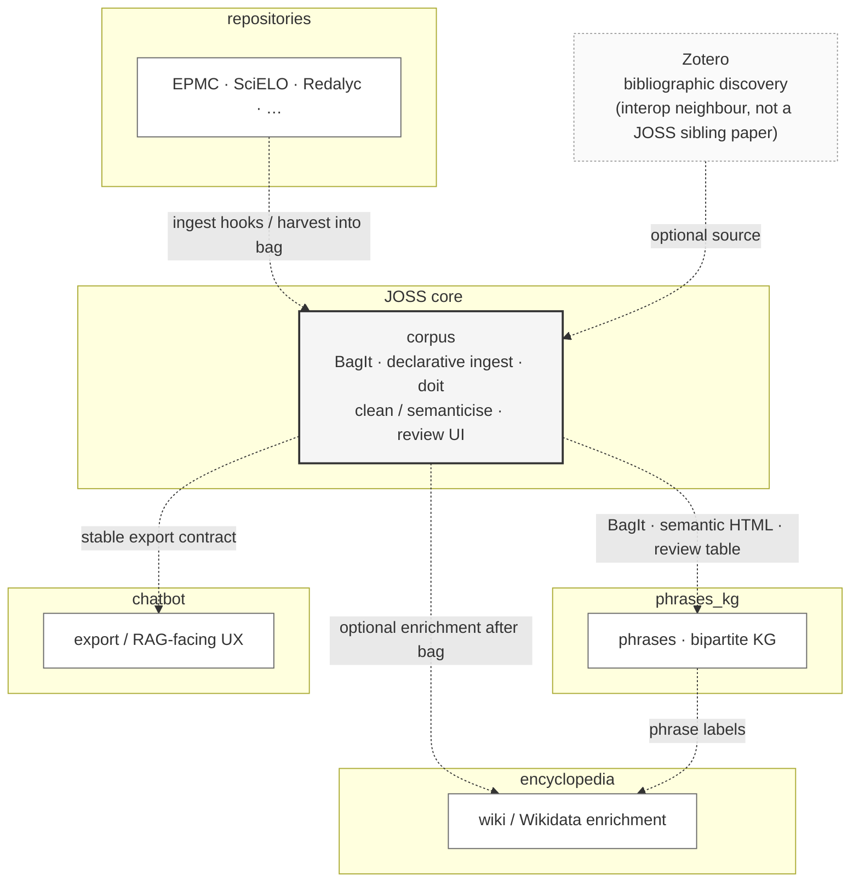

# Sibling modules around `corpus`

**Module:** [`corpus`](overview.md) (core)  
**Series strategy:** [../../joss_series_strategy.md](../../joss_series_strategy.md)  
**Prompt:** [discussions/prompt_2026-11-18_corpus_sibling_schematic.md](../../../discussions/prompt_2026-11-18_corpus_sibling_schematic.md)

`corpus` is the **standalone core**. Sibling themes may **consume** corpus BagIt / semantic HTML / export contracts **or** run on their own inputs. Dotted edges = optional interop (not hard runtime dependency).

---

## Schematic

Solid box = core claim of this repository’s primary paper.  
Dotted links = “may use corpus I/O; each sibling remains independently reviewable.”

---

## Reading the edges

| From → to | Meaning |
|-----------|---------|
| `repositories` -.-> `corpus` | Adapters call **ingest hooks**; may also stand alone |
| `corpus` -.-> `phrases_kg` | Phrases/KG prefer an ingested bag; may use a conforming workdir alone |
| `corpus` -.-> `encyclopedia` | Enrichment after a corpus exists; not required for ingest JOSS |
| `corpus` -.-> `chatbot` | Thin **export** contract here; chat UI may live elsewhere |
| `phrases_kg` -.-> `encyclopedia` | Optional label/disambiguation path |
| `Zotero` -.-> `corpus` | Bibliographic neighbour / optional ingest source ([design.md](design.md) §8.4) |

---

## Related docs

- [overview.md](overview.md) · [design.md](design.md) · [user_narratives.md](user_narratives.md) · [joss_presentation.md](joss_presentation.md)  
- Sibling overviews: [../repositories/overview.md](../repositories/overview.md) · [../phrases_kg/overview.md](../phrases_kg/overview.md) · [../README.md](../README.md)
