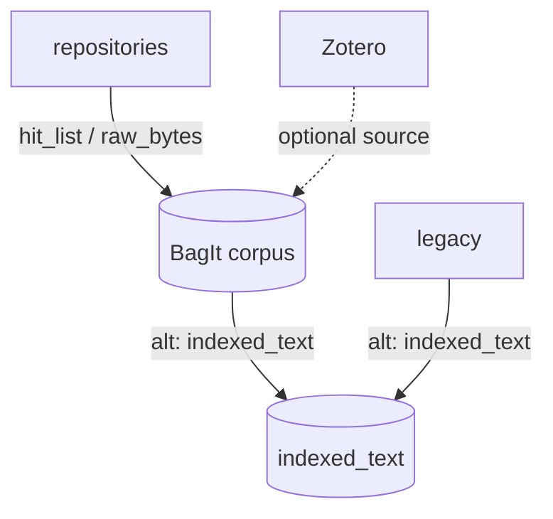
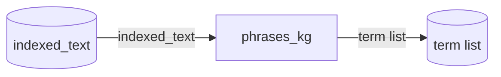
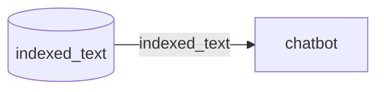
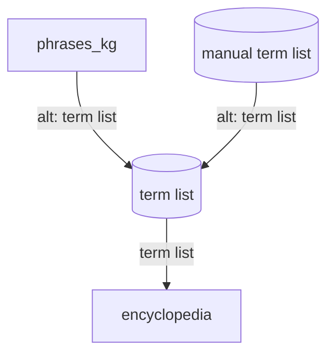
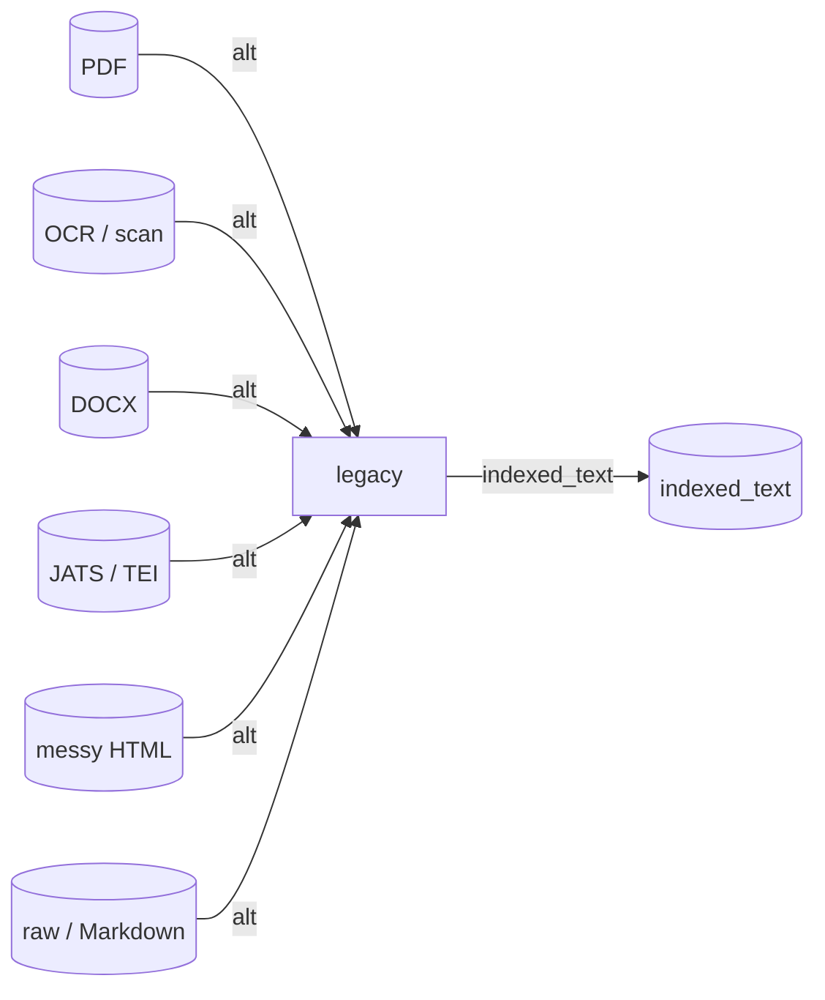

# Sibling modules around `corpus`

**Module:** [`corpus`](overview.md) (core)  
**Series strategy:** [../../joss_series_strategy.md](../../joss_series_strategy.md)  
**Prompt:** [discussions/prompt_2026-11-18_corpus_sibling_schematic.md](../../../discussions/prompt_2026-11-18_corpus_sibling_schematic.md) · [chatbot input + session](../../../discussions/prompt_2026-11-23_chatbot_input_and_session.md)  
**Types:** [`indexed_text` spec](../../../semantic_corpus/corpus/docs/indexed_text.md) · [`text_block`](../../../semantic_corpus/corpus/docs/definitions_text_block.md) · [I/O + storage](../../../semantic_corpus/corpus/docs/types_io_storage.md) · [legacy converter](../../../semantic_corpus/corpus/docs/input_adapters.md)

Downstream consumers share one data product: **`indexed_text`** (indexed semantic text, including metadata / `text_block`s) — **[full specification](../../../semantic_corpus/corpus/docs/indexed_text.md)**. It may come from a BagIt corpus **or** (alternative) from the **`legacy` converter**.

**`phrases_kg` and `chatbot` are independent** — same input type; no dependency on each other.

`indexed_text` may optionally carry page coordinates; that is an adapter concern and is **not** shown on downstream diagrams.

---

## Notation

| Shape | Meaning |
|-------|---------|
| Cylinder `[(…)]` | **Data** |
| Rectangle `[…]` | **Process / program** |
| Arrow title | **Type or role** of the edge |
| **alt** | Exactly one path / format (XOR) — text label on the arrow |  
| **and** | All listed inputs required together — text label on the arrow |

---

## How `indexed_text` is obtained

**`legacy`** is a **converter** (process), not a data store. Its sole typed output is **`indexed_text`**.  
**`alt`:** obtain `indexed_text` from BagIt **or** from `legacy` — not both required.  
**Code:** [`semantic_corpus/corpus/legacy/`](../../../semantic_corpus/corpus/legacy/) — extractors (`pymupdf` / `docling` / `amilib`) → sectioner (ids; optional amilib refine) → `legacy_to_indexed_text`.

---

## Downstream — `phrases_kg` (independent)

---

## Downstream — `chatbot` (independent)

Chatbot **input** only here; chat answers out of scope.

---

## Downstream — `encyclopedia` (independent of chatbot)

Input is a **term list**: **alt** either from `phrases_kg` **or** a manual list.

---

## `legacy` converter — input formats (`alt`)

Accepted source formats are **alternatives** (one document → one format). Detail: [`input_adapters.md`](../../../semantic_corpus/corpus/docs/input_adapters.md).

---

## Reading the edges

| Edge | Kind | Meaning |
|------|------|---------|
| `repositories` → BagIt | data | ingest `hit_list` / `raw_bytes` |
| BagIt → `indexed_text` | **alt** | already indexed in the bag |
| `legacy` → `indexed_text` | **alt** | converter output (sole product) |
| format → `legacy` | **alt** | one source format per document |
| `indexed_text` → `phrases_kg` → term list | process I/O | independent of chatbot |
| `indexed_text` → `chatbot` | process I/O | independent of phrases_kg |
| term list → `encyclopedia` | **alt** | from `phrases_kg` **or** manual list |

---

## Related docs

- [overview.md](overview.md) · [design.md](design.md) · [user_narratives.md](user_narratives.md) · [joss_presentation.md](joss_presentation.md)  
- Legacy export note (pre–text_block): [../../chatbot_export_contract.md](../../chatbot_export_contract.md)  
- Sibling overviews: [../repositories/overview.md](../repositories/overview.md) · [../phrases_kg/overview.md](../phrases_kg/overview.md) · [../README.md](../README.md)
