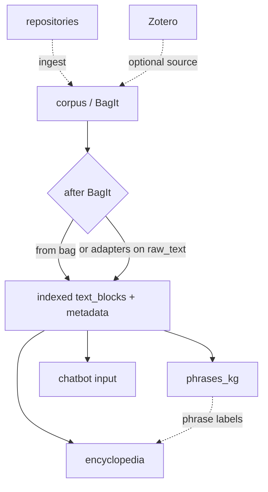

# Sibling modules around `corpus`

**Module:** [`corpus`](overview.md) (core)  
**Series strategy:** [../../joss_series_strategy.md](../../joss_series_strategy.md)  
**Prompt:** [discussions/prompt_2026-11-18_corpus_sibling_schematic.md](../../../discussions/prompt_2026-11-18_corpus_sibling_schematic.md) · [chatbot input + session](../../../discussions/prompt_2026-11-23_chatbot_input_and_session.md)  
**Types:** [`text_block`](../../../semantic_corpus/corpus/docs/definitions_text_block.md) · [I/O + storage](../../../semantic_corpus/corpus/docs/types_io_storage.md)

`corpus` is the **standalone core** (BagIt + metadata + review). Downstream modules share one product: **indexed `text_block`s + metadata**. That product may come from the bag or from adapters on raw text. Dotted edges = optional interop.

**Chatbot input (agreed):** indexed `text_block`s + metadata. Other downstream modules may consume the same.

---

## Schematic

Read top → bottom: intake into **BagIt**, then a **single fork** (bag vs adapters) into the shared product, then a **second fork** to consumers.

---

## Reading the edges

| From → to | Meaning |
|-----------|---------|
| `repositories` / Zotero -.-> `corpus` | Ingest into BagIt (optional for Zotero) |
| after BagIt → product | Either read blocks/metadata from the bag, **or** build them via adapters on `raw_text` |
| product → `phrases_kg` / `encyclopedia` / `chatbot` | Shared downstream input: indexed `text_block`s + metadata |
| `phrases_kg` -.-> `encyclopedia` | Optional label/disambiguation |
| chatbot | Consumes blocks + metadata as **input**; chat answers out of scope here |

---

## Related docs

- [overview.md](overview.md) · [design.md](design.md) · [user_narratives.md](user_narratives.md) · [joss_presentation.md](joss_presentation.md)  
- Legacy export note (pre–text_block): [../../chatbot_export_contract.md](../../chatbot_export_contract.md)  
- Sibling overviews: [../repositories/overview.md](../repositories/overview.md) · [../phrases_kg/overview.md](../phrases_kg/overview.md) · [../README.md](../README.md)
