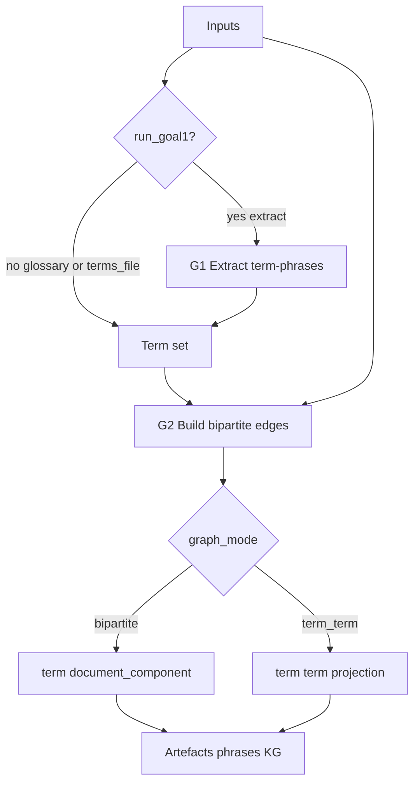
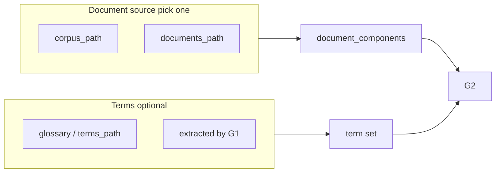
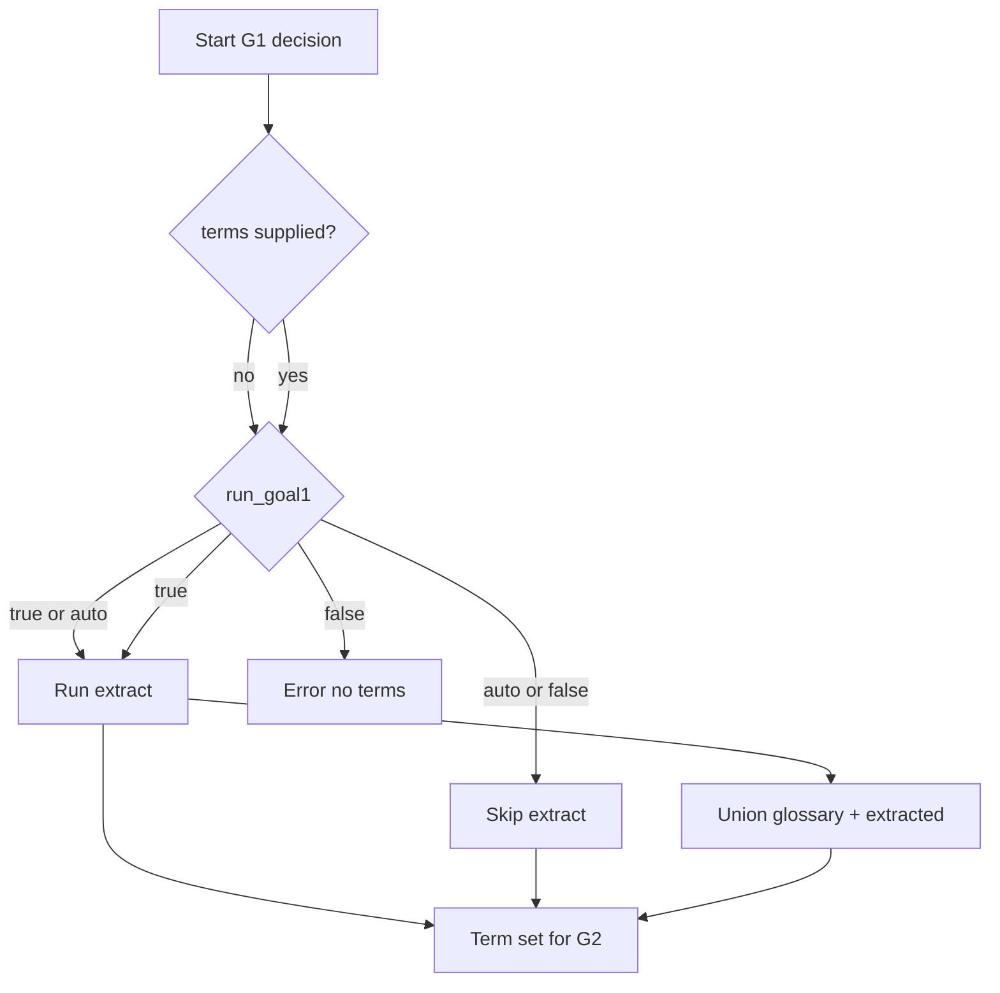
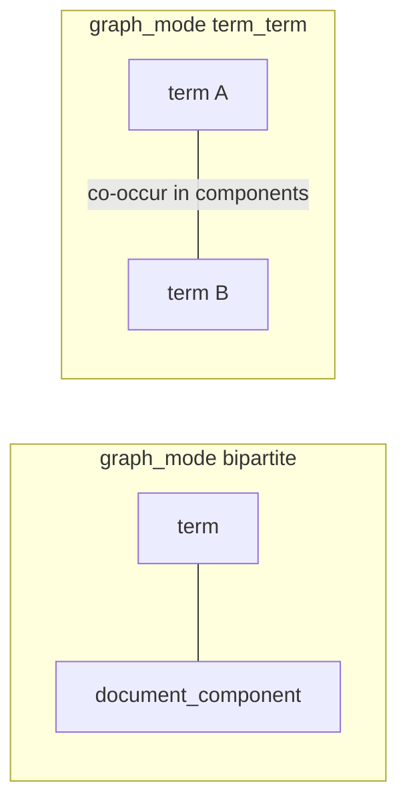

# Declarative controls — `phrases_kg`

**Module:** [`phrases_kg`](overview.md)  
**Package docs:** [`semantic_corpus/phrases_kg/docs/`](../../../semantic_corpus/phrases_kg/docs/)  
**Prompt:** [discussions/prompt_2026-11-20_phrases_kg_controls.md](../../../discussions/prompt_2026-11-20_phrases_kg_controls.md)  
**Status:** specification (normative for pilots; legacy `cluster_review` step2/step3 implement a subset)  
**Interfaces:** honour [`corpus/`](../corpus/overview.md) BagIt / semantic HTML / IDs — [submodule guidelines](../../../semantic_corpus/corpus/docs/submodule_guidelines.md)

Two goals, one pipeline. Controls decide whether Goal 1 runs, what document units enter Goal 2, and how the bipartite graph is projected for output.

| Goal | Name | Purpose |
|------|------|---------|
| **G1** | Phrase / term extraction | Discover term-phrases from document text |
| **G2** | Knowledge graph | Link terms to document components (bipartite), optionally project to term↔term |

---

## 1. Pipeline overview



**Skip G1** when terms are supplied (glossary / curated list). G2 always needs (a) a term set and (b) document components derived from the input documents or corpus.

---

## 2. Inputs

Exactly one **document source** is required. Terms are optional.

| Input | Control | Meaning |
|-------|---------|---------|
| **Corpus** | `input.kind: corpus` + `input.corpus_path` | BagIt or conforming workdir from `corpus/` (preferred) |
| **Documents** | `input.kind: documents` + `input.documents_path` | Flat dir or file list of XML/HTML/PDF/txt (standalone; no bag required) |
| **Terms (optional)** | `input.terms_path` or `input.terms` | Glossary / stop-in list; **implies skip G1** unless `run_goal1: true` forces merge |



### 2.1 Document components (nodes on the document side)

Controlled by `document_unit` (what becomes a bipartite node):

| `document_unit` | Node identity | Typical text |
|-----------------|---------------|--------------|
| `document` | paper / file id | whole body (legacy paper↔term) |
| `section` | paper_id + section_id | section text from semantic HTML |
| `paragraph` | paper_id + para_id | paragraph chunks |
| `caption` | paper_id + fig/table id | figure/table captions |
| `packet` | packet id | cluster_review packet index text |

Default for v1 JOSS path: `document` (matches current step3). Finer units require corpus semantic HTML / packet indexes.

---

## 3. Shared pilot controls (canonical)

Used in every `phrases_kg` pilot:

| Control | Type | Default | Meaning |
|---------|------|---------|---------|
| `run_name` | string | required | Short label for this run / output subdir |
| `input.kind` | `corpus` \| `documents` | `corpus` | Document source mode |
| `input.corpus_path` | path | — | Required if `kind: corpus` |
| `input.documents_path` | path | — | Required if `kind: documents` |
| `input.terms_path` | path \| null | null | Optional glossary / term list file |
| `input.terms` | list[string] \| null | null | Inline terms (small demos only) |
| `run_goal1` | bool \| `auto` | `auto` | `auto` = run G1 iff no terms supplied |
| `run_goal2` | bool | `true` | Build KG; if false, stop after phrases/terms |
| `document_unit` | enum | `document` | See §2.1 |
| `graph_mode` | `bipartite` \| `term_term` | `bipartite` | See §5 |
| `output_subdir` | string | `run_name` | Under corpus indexes or declared out dir |
| `limit_documents` | int \| null | null | Cap docs this run (demo / CI) |
| `reuse_existing` | bool | `true` | Skip-satisfied caches when params match |
| `timing` | `off` \| `summary` | `off` | Mentoring diagnostics |

---

## 4. Goal 1 — extract term-phrases (controls)

Runs only when `run_goal1` is true, or `auto` and no terms were supplied.

| Control | Type | Default | Meaning |
|---------|------|---------|---------|
| `goal1.method` | `tfidf` \| `yake` \| `proper` \| `merge_tfidf_proper` | `tfidf` | Extraction engine |
| `goal1.top_n` | int | e.g. 20 | Max phrases kept per document unit |
| `goal1.ngram_min` / `ngram_max` | int | 1 / 3 | n-gram window (method-dependent) |
| `goal1.text_fields` | list | `[body]` | Which fields: `body`, `title`, `abstract`, `captions` |
| `goal1.include_front_matter` | bool | `false` | Include front matter |
| `goal1.skip_sections` | list | refs / acknowledgments-like | Section name patterns to drop |
| `goal1.stop_lists` | list[path] | module `lists/` | Discourse / stop phrase files |
| `goal1.min_score` / rank rule | number \| null | method default | Keep threshold |
| `goal1.phrase_schema` | string | `v1` | `{phrase, display, score}` contract version |

**Outputs (G1):** `phrases/index.json`, per-doc phrase JSON, optional CSV summaries — under corpus `data/indexes/phrases/` when input is a bag.

**Skip / merge behaviour:**

| Situation | Behaviour |
|-----------|-----------|
| Terms only, `run_goal1: auto` | Skip G1; term set = file/list |
| Terms + `run_goal1: true` | Extract, then **union** with supplied terms (supplied terms get score sentinel / `source: glossary`) |
| No terms, `run_goal1: false` | **Error** — G2 has no term set |



---

## 5. Goal 2 — knowledge graph (controls)

Requires a term set (§4) and document components (§2.1).

### 5.1 Edge construction (always bipartite underneath)

| Control | Type | Default | Meaning |
|---------|------|---------|---------|
| `goal2.match` | `exact` \| `normalized` \| `contains` | `normalized` | How a term hits component text |
| `goal2.casefold` | bool | `true` | Case-insensitive match |
| `goal2.min_term_docs` | int | 1 | Drop terms linked to fewer than N components |
| `goal2.min_doc_terms` | int | 1 | Drop components with fewer than N terms |
| `goal2.weight` | `binary` \| `count` \| `tfidf_edge` | `binary` | Edge weight semantics |
| `goal2.clustering` | `none` \| `louvain` | `louvain` | Optional communities on the working graph |
| `goal2.resolution` | float | algo default | Louvain resolution when clustering |

Bipartite edge: **term — document_component** when the term matches that component’s text under `goal2.match`.

### 5.2 Graph mode (what we emit / analyse)

| `graph_mode` | Working graph | Meaning |
|--------------|---------------|---------|
| `bipartite` | Keep both partitions | term ↔ document_component (default; legacy paper↔term) |
| `term_term` | Project: suppress document side | term ↔ term if they co-occur in ≥ `goal2.cooccurrence_min` shared components |

| Extra control | Type | Default | When |
|---------------|------|---------|------|
| `goal2.cooccurrence_min` | int | 1 | `graph_mode: term_term` — min shared components to link two terms |
| `goal2.keep_bipartite_artefact` | bool | `true` | Always write bipartite edges even if analysis uses projection |



**Outputs (G2):** `clusters/` or `kg/` — e.g. `clusters.json`, `orphans.json`, `graph_summary.json`, edge list, optional HTML — paths aligned with existing `data/indexes/clusters/` when using a corpus.

---

## 6. Example pilots

### 6.1 Full pipeline — corpus, extract then bipartite KG

```yaml
run_name: phrases_kg_heatwaves_demo
input:
  kind: corpus
  corpus_path: corpora/epmc_limit2_demo
run_goal1: auto
run_goal2: true
document_unit: document
graph_mode: bipartite
limit_documents: 2
goal1:
  method: tfidf
  top_n: 20
  text_fields: [body]
  include_front_matter: false
goal2:
  match: normalized
  weight: binary
  clustering: louvain
  keep_bipartite_artefact: true
reuse_existing: true
```

### 6.2 Glossary only — skip G1, term↔document

```yaml
run_name: glossary_on_corpus
input:
  kind: corpus
  corpus_path: corpora/epmc_limit2_demo
  terms_path: config/glossaries/climate_terms.txt
run_goal1: auto          # skips extract
run_goal2: true
document_unit: paragraph
graph_mode: bipartite
goal2:
  match: contains
  min_term_docs: 1
```

### 6.3 Documents dir + term–term projection

```yaml
run_name: flat_docs_term_graph
input:
  kind: documents
  documents_path: samples/xml_mini/
  terms_path: config/glossaries/climate_terms.txt
run_goal1: false
run_goal2: true
document_unit: document
graph_mode: term_term
goal2:
  cooccurrence_min: 2
  clustering: louvain
  keep_bipartite_artefact: true
```

### 6.4 Extract only (no KG)

```yaml
run_name: phrases_only
input:
  kind: corpus
  corpus_path: corpora/epmc_limit2_demo
run_goal1: true
run_goal2: false
goal1:
  method: merge_tfidf_proper
  top_n: 15
```

---

## 7. Launcher contract (CLI / GUI)

Same library API for CLI and Streamlit ([submodule guidelines](../../../semantic_corpus/corpus/docs/submodule_guidelines.md) §3.1):

| Operation | Library | Notes |
|-----------|---------|-------|
| Load pilot | `load_phrases_kg_pilot(path) -> dict` | Validate keys; resolve `run_goal1: auto` |
| Run G1 | `extract_phrases(...)` | No-op / skip when terms-only |
| Run G2 | `build_kg(...)` | Honours `graph_mode` |
| Run both | `run_phrases_kg(pilot) -> RunResult` | Orchestrates skip-satisfied |

CLI: `semantic_corpus phrases-kg --config path.yaml`  
GUI: widgets bind to the same pilot dict; do not reimplement matching in Streamlit.

---

## 8. Acceptance / skip-satisfied

Caches are current when recorded `params` match the pilot subset that affects that stage:

| Stage | Stamp / index fields |
|-------|----------------------|
| G1 | `method`, `top_n`, n-grams, `text_fields`, `include_front_matter`, `phrase_schema`, document count / ids |
| G2 | term-set hash, `document_unit`, `graph_mode`, match/weight/clustering params, component count |

`reuse_existing: false` forces rebuild.

---

## 9. Out of scope (this control surface)

- Ingest / BagIt creation → `corpus`
- Repository download → `repositories`
- Encyclopedia label attach → bridge (may consume term nodes later)
- Embedding-only / LLM-first phrase engines as the default path

---

## 10. One sentence

**`phrases_kg` takes documents or a corpus, optionally a glossary (skipping extraction), builds term↔document_component edges, and either keeps that bipartite graph or projects it to term↔term—controlled entirely by a small declarative pilot.**
