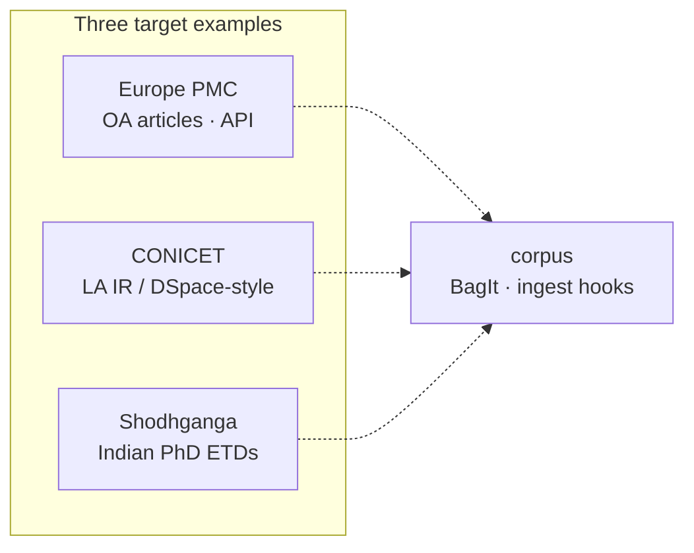

# Target repository examples (declarative pilots)

**Module:** [`repositories`](overview.md)  
**Strategy:** [strategy.md](strategy.md)  
**Prompt:** [discussions/prompt_2026-11-19_repositories_three_examples.md](../../../discussions/prompt_2026-11-19_repositories_three_examples.md)

For design, docs, timing demos, and JOSS evidence we standardise on **three target repositories**—diverse by region, access pattern, and material type. Other adapters (SciELO, Redalyc, OpenAlex, …) remain in scope but are not the primary teaching set.

---

## The three

| # | Profile id | Source | Region / role | Why it is a target example |
|---|------------|--------|---------------|----------------------------|
| 1 | `epmc` / Europe PMC | [Europe PMC](https://europepmc.org/) | Global OA articles (API-friendly) | pygetpapers-strong; Boolean + dates; reference for declarative search and corpus hand-off |
| 2 | `conicet` / CONICET | CONICET digital / DSpace-style IR ([adapter in tree](../../../semantic_corpus/repositories/conicet.py)) | Latin America / Argentina | Existing GS adapter; institutional / national research outputs; stress HTML/IR realities (e.g. 403, pagination) vs pure REST |
| 3 | `shodhganga` / Shodhganga | [Shodhganga](https://shodhganga.inflibnet.ac.in/) (INFLIBNET) | South Asia / India **PhD theses** | Planned expansion; thesis-shaped personal corpora; see [south_asia.md](south_asia.md) |

Dotted edges: harvest into shared **`corpus` contracts** (not a parallel filestore).

---

## What “target” means

| Expectation | EPMC | CONICET | Shodhganga |
|-------------|------|---------|------------|
| Declarative profile (goal) | Reference profile first | Migrate/strengthen existing adapter → profile | New profile when access + volunteer allow |
| Boolean + date query | Strong | As remote allows; document degraded mode | As remote allows; document honestly |
| Timing example (when requested) | Yes | Yes (contrast with API-fast EPMC) | Yes when pilot exists |
| HTTP state demos (e.g. 403) | UA / policy cases | IR / scrape-style cases | Confirm before claiming |
| Feed `corpus` ingest hooks | Required | Required | Required |
| JOSS narrative | Core OA search path | Global South / LA institutional | South Asia theses |

---

## Diversity checklist (why three, not one)

1. **API vs IR** — Europe PMC vs CONICET-style repository UX.  
2. **Articles vs theses** — EPMC/CONICET-style outputs vs Shodhganga ETDs.  
3. **Geography** — global OA hub, Latin America, South Asia.  
4. **Maturity** — in-tree + pygetpapers (EPMC), in-tree GS (CONICET), planned (Shodhganga).

---

## Related

- **Declarative controls** (pilot + per-site profile): [declarative_controls.md](declarative_controls.md)  
- South Asia / Shodhganga detail: [south_asia.md](south_asia.md)  
- Full strategy: [strategy.md](strategy.md)  
- Sibling schematic: [../corpus/siblings.md](../corpus/siblings.md)
