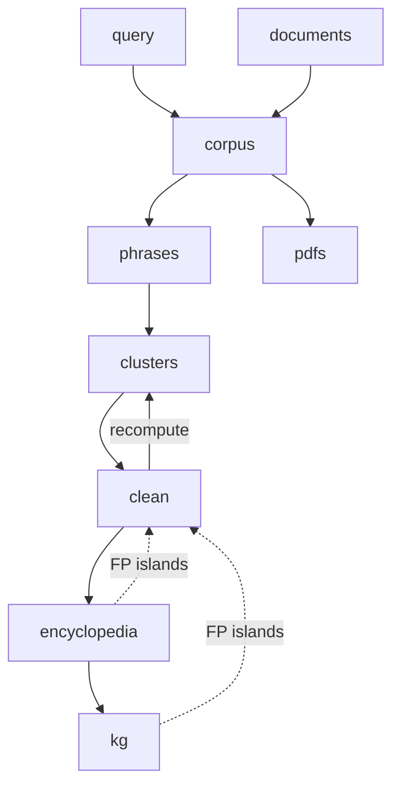

# Cluster-review / AUKGET pipeline design (doit)

**Date:** 2026-11-03  
**Status:** `pipeline` CLI live; **`query` / `corpus` / `phrases` / `clusters` wired**; other steps still stubs  
**Orchestration choice:** [pipeline_make_doit.md](pipeline_make_doit.md) (prefer **doit**)  
**Tutorial (start here):** [pipeline.md](pipeline.md)  
**Workflow context:** [cluster_filtering_workflow.md](cluster_filtering_workflow.md)

This document specifies the **symbolic pipeline** in detail: inputs, outputs, skip-if-done rules, dependencies, and cleaning loops. UI step numbers (0–6) may change; **symbols do not**.

---

## 1. Goals

1. Material via **`--query`** (live search) *or* **`--source`** (local docs) *or* neither (existing bag under `--workdir`).  
2. Goal via **`--target`** (stable step symbols; no numeric `--from-step`).  
3. **Skip-if-done** via doit (`file_dep` / `targets` / `uptodate`).  
4. Same tasks from **CLI** and **Streamlit** (`DoitMain`, not `doit.run()` / `sys.exit`).  
5. Graph-based **cleaning loops** (BKG + encyclopedia/KG), not a final “Step 7 remove FPs”.

---

## 2. Symbolic targets (canonical names)

| Symbol | Role | Implemented today? |
|--------|------|--------------------|
| `query` | Search + download into a harvest dir | Partial (Step 0) |
| `documents` | Alternate entry: local docs / prior downloads (no live search) | Partial (ingest paths) |
| `corpus` | Ensure BAGIT corpus under `--workdir` (produced by `query`/`documents`) | Partial (Step 0/1) |
| `phrases` | Keyphrase extract → `phrases/` | Yes (Step 2) |
| `clusters` | Bipartite KG (BKG) + Louvain → `clusters/` | Yes (Step 3) |
| `pdfs` | Fill missing valid PDFs into the bag | Yes (`update_bagit_formats`) |
| `clean` | Human/graph-guided FP paper + FP term removal; recompute loop | No |
| `encyclopedia` | Wikipedia entries for retained phrases | No |
| `kg` | Linked knowledge graph (corpus ↔ encyclopedia / Wikidata) | No |

**Entry rule:** exactly one of `query` or `documents` feeds `corpus` (or `corpus` alone if the corpus already exists).

---

## 3. Dependency graph

```text
                    ┌──────── query ────────┐
                    │                       │
                    ▼                       ▼
               documents ─────────────► corpus
                                          │
                    ┌─────────────────────┼─────────────────────┐
                    ▼                     ▼                     ▼
                 phrases                pdfs              (optional later)
                    │                     │
                    ▼                     │
                 clusters ◄───────────────┘  (pdfs do not block clusters)
                    │
         ┌──────────┴──────────┐
         ▼                     ▼
       clean ◄────────── encyclopedia
         │                     │
         │                     ▼
         │                    kg  (optional partner to encyclopedia / clean)
         ▼
      (export / orphans fold into clean completion)
```



**Parallelism:** `pdfs` may run beside `phrases`/`clusters` (both need `corpus` only). Default “full demo” target can be `clusters` without waiting on `pdfs`.

**Default CLI targets:**

| User intent | doit target |
|-------------|-------------|
| Worked example through BKG | `clusters` |
| Add PDFs anytime | `pdfs` |
| Curate FPs | `clean` (implies current `clusters`) |
| Encyclopedia + linked KG | `kg` (implies `encyclopedia`, prefers cleaned phrases) |

---

## 4. Shared context (run parameters)

All tasks read a small **run context** (CLI flags / Streamlit session / env):

| Param | Meaning | Default sketch |
|-------|---------|----------------|
| `query_name` | Run / corpus slug | e.g. `amoc_india_2026` |
| `query` / `--query` | Live search string | e.g. `AMOC AND India` |
| `source` / `--source` | Local documents path/glob | e.g. `wg2/chapter[2-6]` |
| `query_dir` | Harvest directory | `temp/queries/<query_name>/` |
| `corpus_dir` / `--workdir` | BAGIT root | `corpora/<query_name>/` |
| `repository` | Adapter key(s) | `europe_pmc` |
| `limit` / `--limit` | Max papers for `--query` | `50` |
| `formats` | Harvest formats | `xml` (pdfs via `pdfs` task) |
| `phrase_method` | `tfidf` \| `yake` | `tfidf` |
| `phrase_n` / `phrase_top` | n-gram / top-k | `3` / `15` |
| `cluster_resolution` | Louvain resolution | `1.0` |
| `doit_db` | Per-corpus dependency DB | `temp/pipeline_doit/<name>_<hash>/doit.db` (outside BAGIT root) |

Force semantics: `doit forget <task>` or task-specific `--force` / Streamlit “Force re-run” clears uptodate for that task (and optionally downstream).

---

## 5. Per-task design

### 5.1 `query` — live harvest

**Purpose.** Search repositories and download full text into `query_dir`.

**Inputs.** `query_string`, `repository`, `limit`, `formats`, date bounds.

**Actions.** Existing `create_corpus_from_query` harvest portion (or `run_repository_search` + download); write `search_results.json`, `query_run.json`, per-id XML/PDF under `query_dir`.

**Targets / uptodate.**

- Target: `query_dir/search_results.json`  
- Current if: file exists and `query_run.json` records same `query_string`, `limit`, `repository`, `formats` (custom `uptodate`), **unless** force.  
- Does **not** require bag yet.

**Failure.** Network / 403 / zero hits → task fails; do not mark corpus current.

**Streamlit.** Stage “Query → BAGIT”; button “Run query”.

---

### 5.2 `documents` — alternate entry (no live search)

**Purpose.** Start from materials already on disk: prior `query_dir`, local PDF/XML folder, or an existing incomplete bag payload.

**Inputs.** One of:

- `--query-dir` with existing downloads, or  
- `--documents-dir` of XML/PDF files, or  
- “use files already under `corpus_dir/data/documents/`”

**Actions.** Validate files; optionally copy/normalize into a staging `query_dir` or directly prepare for bag ingest. **No network search.**

**Targets / uptodate.**

- Staging manifest e.g. `query_dir/documents_manifest.json` listing stems + checksums.  
- Current if manifest matches on-disk files.

**Mutual exclusion.** `--query` and `--source` cannot both be set. If neither is set, start mode is `existing` (bag under `--workdir`). doit: `corpus` depends on `query` or `documents` accordingly, or on nothing.

**Streamlit.** Entry mode toggle: “Create from query” vs “Load documents / existing harvest”.

---

### 5.3 `corpus` — BAGIT package at `--workdir`

**Purpose.** Ensure a BAGIT corpus at `corpus_dir` with metadata + review table, ready for phrases/pdfs.

**Depends on.** `query` **or** `documents`, **or** already-valid bag (skip entry).

**Actions.**

- If bag missing: ingest harvest/docs → `CorpusManager` / existing ingest (`query_output_ingester` etc.).  
- If bag present: `load_bagit_corpus` (validate, pin paper list, ensure `review/`).  
- Update manifests.

**Targets / uptodate.**

- `corpus_dir/bagit.txt`  
- `data/metadata/*_metadata.json` count ≥ 1  
- Optional stamp `corpus_dir/pipeline/corpus.stamp` with paper_count + source entry hash  
- Current if bagit.txt exists, paper_count stable vs stamp, review table present (or auto-build allowed)

**Outputs.** `corpus_dir/` BAGIT tree; `review/review_table.json`.

**Streamlit.** “Load BAGIT” / post-query “Create BAGIT”.

---

### 5.4 `phrases` — keyphrase extraction

**Purpose.** Build per-paper phrase caches for the BKG.

**Depends on.** `corpus`.

**Actions.** `extract_phrases` (default TF-IDF, XML **body only**, uppercase/titlecase phrases; YAKE optional). Writes `phrases/`.

**Policy (fixed for v1 design).**

- Index text: XML body; skip front matter; skip References / Acknowledgments-like sections.  
- Stop lists under `cluster_review/lists/` (incl. `scientific_discourse.txt`).  
- Phrase object: `{phrase, display, score}`.

**Targets / uptodate.**

- `phrases/index.json`  
- Current if: index exists; `paper_count` equals bag paper count; `params` match (`method`, `n`, `top`, `text_fields`, `include_front_matter`, `phrase_schema`) — reuse Step 2 cache-matching logic.  
- Per-paper JSON may still be filled incrementally inside the action if partially present.

**Does not depend on.** `pdfs` (phrases are XML-first).

**Streamlit.** Stage Phrases; “Extract” / “Use cache” maps to run vs skip.

---

### 5.5 `clusters` — BKG + community detection

**Purpose.** Build bipartite paper↔term knowledge graph (BKG) and Louvain clusters.

**Depends on.** `phrases`.

**Actions.** `build_clusters` → `clusters/clusters.json`, `orphans.json`, `graph_summary.json`.

**Targets / uptodate.**

- `clusters/graph_summary.json`  
- Current if: exists; `mtime ≥ phrases/index.json`; `paper_count` / phrase method in summary consistent with phrase index.  
- Resolution / algorithm changes invalidate via params recorded in summary + `uptodate` check.

**Outputs for downstream.** Cluster themes, member papers, member terms (with `display`), orphans.

**Streamlit.** Stage BKG clusters (read-only until `clean`).

---

### 5.6 `pdfs` — update BAGIT with PDFs

**Purpose.** Download missing **valid** PDFs into `data/documents/pdf/` without re-querying.

**Depends on.** `corpus` only (can run in parallel with phrases/clusters).

**Actions.** `update_bagit_formats(..., formats=["pdf"])`.

**Validation.** `%PDF` magic + min size (reject HTML 403/500 stubs). Skip valid existing files unless force.

**Targets / uptodate.**

- Soft current: fraction of papers with valid PDF ≥ threshold **or** stamp listing attempted PMCIDS + failures.  
- Practical doit shape: task always “considers” bag; action no-ops when all present; stamp `pipeline/pdfs.stamp` with `{downloaded, skipped, failed, paper_count}`.  
- Force re-download: forget stamp + `force=True`.

**Streamlit.** Sidebar / Step 1 “Update corpus files (PDF)” → `doit pdfs`.

---

### 5.7 `clean` — FP papers and FP terms (BKG loop)

**Purpose.** Human-in-the-loop (and graph-assisted) removal of false-positive **papers** and **terms** using the BKG; optionally recompute clusters.

**Depends on.** `clusters` (current).

**Actions (design).**

1. Load `clusters.json` + review table + phrase index.  
2. Curator Keep / Remove / Unsure / Inspect on clusters; demote FP terms; override individual papers.  
3. Persist:  
   - `review/review_table.json` (`include` / `exclude` / `review`)  
   - `clusters/decisions.json`  
   - `clusters/demoted_terms.json`  
   - `clusters/audit_log.jsonl`  
4. Optional **recompute**: filter phrases (drop demoted terms; drop excluded papers) → rebuild BKG → refresh `clusters/` (**loop back toward `clusters`**).  
5. Orphans: Keep/Remove singleton papers; write `orphan_decisions.json`; fold export snapshot under `export/` when curation session ends.

**Targets / uptodate.**

- Not “auto-current” after first click — curation is iterative.  
- Stamp `pipeline/clean.stamp` when curator marks session “stable” (or when export written).  
- doit: `clean` may be a **long-running interactive** task from Streamlit (UI owns the loop); CLI may only apply a saved decisions file + recompute (`clean --apply decisions.json`).

**Feedback from encyclopedia/kg.** Island term/paper IDs proposed as FP candidates; curator must confirm (no auto-delete).

**Streamlit.** Stage “BKG clean”; primary curation screen.

---

### 5.8 `encyclopedia` — Wikipedia entries for phrases

**Authoritative definition:** [pipeline_encyclopedia.md](pipeline_encyclopedia.md).

**Purpose.** Resolve retained phrases to Wikipedia pages + Wikidata ids; cache under `encyclopedia/`. Does not build the multi-edge KG (`kg` does).

**Depends on.** `clean` (graph); prefer Keep / non-demoted terms.

**Flags.** `--encyclopedia-lang`, `--max-entries`.

**Outputs.** `encyclopedia/entries.json`, `fetch_log.jsonl`, `pipeline/encyclopedia.stamp`.

**Partner sketch:** [pipeline_next_encyclopedia_kg.md](pipeline_next_encyclopedia_kg.md).

---

### 5.9 `kg` — linked knowledge graph + display

**Purpose.** Build a **displayable** KG from the cluster BKG (papers ↔ phrases), optionally attaching encyclopedia entities. Generate typed edges from selectable link tools; surface **islands** as FP hints for `clean`.

**Depends on.** `clusters` (encyclopedia is optional soft-attach when `entries.json` exists).

**Flags.** `--kg-links clusters,wikipedia,wikidata`, `--kg-max-island`.

**CLI.** `pipeline kg --workdir … --kg-links clusters,wikipedia --open`

**Edge / link generators.**

| Source (`--kg-links`) | Edges (v1) |
|-----------------------|--------|
| `clusters` | Paper↔phrase from the BKG (required core) |
| `wikipedia` | Attach encyclopedia entity nodes when `entries.json` exists |
| `wikidata` | Reserved (structured neighbours / embeddings — not yet wired) |

**Actions.**

1. Nodes: papers, phrases; optional wiki entities from encyclopedia.  
2. Run selected link tools; tag each edge with `source`.  
3. Write `kg/graph.json` + `kg/islands.json` + `kg/kg_summary.json` + `kg/knowledge_graph.html`.  
4. **Display:** vis-network HTML (`--open` opens the browser); Streamlit stage later.

**Targets / uptodate.**

- `kg/graph.json`, `kg/knowledge_graph.html`  
- Current if newer than `clusters/` (and `encyclopedia/entries.json` when used) and selected `--kg-links` params.

**Relationship to `encyclopedia`.**  
- `encyclopedia` = per-phrase page resolution (optional input).  
- `kg` = graph assembly + link tools + island detection + HTML.  
- Optional partner to `clean`: islands feed candidate FP terms/papers (**human confirms**).

**Detail:** [pipeline_next_encyclopedia_kg.md](pipeline_next_encyclopedia_kg.md).

---

## 6. Cleaning loops (explicit)

### Loop A — BKG (`clusters` ↔ `clean`)

1. `clusters` proposes themes.  
2. `clean` drops FP papers and FP terms.  
3. Recompute `clusters` on Keep set.  
4. Repeat until curator stamps clean stable.

### Loop B — Encyclopedia / KG → `clean`

1. `encyclopedia` + `kg` expose off-topic islands (methods labs, author-name islands, biomedical hitchhikers, etc.).  
2. Curator imports island members into `clean` as suggested removes.  
3. No automatic exclusion.

There is **no** separate final “remove FPs only” stage after KG.

---

## 7. Artifact layout (corpus-centric)

```text
temp/queries/<query_name>/          # query or documents staging
  search_results.json               # query only
  documents_manifest.json           # documents entry
  *.xml / *.pdf

corpora/<query_name>/
  bagit.txt
  pipeline/                         # stamps (design)
  # doit DB: temp/pipeline_doit/… (not inside bag — make_bag moves top-level files)
    corpus.stamp
    pdfs.stamp
    clean.stamp
  data/documents/{xml,pdf,html}/
  data/metadata/
  review/
  phrases/
  clusters/
  encyclopedia/
  kg/                               # or encyclopedia/kg_*
  export/
```

Harvest dir remains **not** the phrase/cluster workspace.

---

## 8. CLI / Streamlit UX (design)

### CLI (doit)

```bash
# Through BKG; skips current steps
doit clusters

# PDFs anytime
doit pdfs

# Apply curation + recompute (non-interactive)
doit clean

# Encyclopedia then KG
doit kg

# Force remake phrases and dependents
doit forget phrases clusters && doit clusters
```

### Streamlit

- Sidebar lists **symbols** (and optional display numbers).  
- Buttons: “Ensure `corpus`”, “Ensure `phrases`”, … call `DoitMain(...).run(["run", "phrases"])`.  
- Interactive `clean` / `kg` island review stay in Streamlit; doit used for ensure/recompute/apply.

---

## 9. Failure and partial states

| Situation | Behaviour |
|-----------|-----------|
| `query` fails mid-download | No corpus stamp; retry `query` |
| Some PDFs fail | `pdfs` completes with `failed` list; does not fail whole pipeline |
| Phrase empty text | Paper recorded empty; clusters may orphan |
| Clean without clusters | Error: run `clusters` first |
| Encyclopedia API rate limit | Partial entries + resume via uptodate on missing phrases |
| Invalid HTML “PDF” | Rejected; counted failed; never stamped valid |

---

## 10. Testing strategy (when implementing)

- Unit: `uptodate` helpers for phrases index params; bag paper_count; clusters mtime.  
- Integration: fake `query`/`documents` → `corpus` → `phrases` → `clusters` without network.  
- `pdfs`: mock downloader; HTML stub rejected.  
- `clean` apply: decisions file → demoted terms absent after recompute.  
- No live Wikidata in CI for `encyclopedia`/`kg` (fixtures).

---

## 11. Out of scope for this design doc

- Implementing doit tasks or Streamlit wiring (see follow-on implementation).  
- KBIR as the phrase engine (TF-IDF/YAKE remain default in `phrases`).  
- Auto-deletion of FPs without human confirm.  
- Numeric `--from-step` / `--to-step` (deprecated by symbols).

---

## 12. Summary

| Symbol | One-line contract |
|--------|-------------------|
| `query` \| `documents` | Get raw materials (network **or** local) |
| `corpus` | Ensure BAGIT corpus under `--workdir` (from query/source) |
| `phrases` | Body-only keyphrases + display forms |
| `clusters` | BKG + Louvain themes |
| `pdfs` | Valid PDFs into the bag (parallel-safe) |
| `clean` | Weed FP papers/terms; recompute BKG |
| `encyclopedia` | Wiki/Wikidata entries for kept phrases |
| `kg` | Linked graph + islands → feedback to `clean` |

Orchestration: **doit**; UI: **Streamlit** triggers the same tasks.
