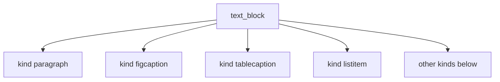

# Corpus definition — Text block (“paragraph” units)

**Date:** 2026-11-20  
**Owner:** `corpus/` (definitions for all modules)  
**Prompt:** [discussions/prompt_2026-11-20_paragraph_definition.md](../../../discussions/prompt_2026-11-20_paragraph_definition.md)  
**Related:** [submodule_guidelines.md](submodule_guidelines.md) · [phrases_kg controls](../../../docs/modules/phrases_kg/controls.md) (`document_unit`) · [design.md](../../../docs/modules/corpus/design.md)

Corpus publishes shared vocabulary. Downstream modules (`repositories`, `phrases_kg`, encyclopedia, chatbot) **consume** these types; they do not redefine them.

---

## 1. Working definition (your text, normalised)

> A **text block** is a chunk of text without natural internal structure other than sentences.

It can be realised as (among others):

- a prose paragraph  
- a figure caption  
- a table caption  
- a list element  

A text block is **semantically definable by an HTML element** (or a documented mapping onto one) and is **indexable uniquely within the document** (stable id scoped by `paper_id` / document id).

---

## 2. Better name than “paragraph”?

**Recommendation:** use **`text_block`** (type / API / YAML) as the abstract name; keep **`paragraph`** as one *kind* and as informal speech.

| Name | Verdict |
|------|---------|
| **`text_block`** | Best default: covers captions and list items without lying; maps cleanly to HTML block elements |
| `paragraph` | Too tied to `
` and to “body prose”; captions/list items are not paragraphs in authors’ minds |
| `chunk` | Avoid as the type name — clashes with RAG “chunking” and arbitrary splitters |
| `segment` / `span` | Fine in NLP; `span` usually means character offsets, not a whole block |
| `passage` | Usually multi-paragraph retrieval unit — too large |
| `atomic_unit` / `leaf_block` | Accurate but jargon-heavy for JOSS/ECR docs |

**ID pattern (sketch):** `{paper_id}#{kind}-{local_id}`  
e.g. `europe_pmc_PMC123#p-014`, `…#figcaption-2`, `…#li-3-1`.

In `phrases_kg` pilots, `document_unit: paragraph` should eventually mean **`text_block`** (or an alias); finer filters use `kinds: […]`.

---

## 3. Kinds you listed + suggested additions

### 3.1 Include as `text_block` kinds

| Kind (slug) | Typical HTML | Notes |
|-------------|--------------|-------|
| `paragraph` | `
` | Body / abstract prose |
| `figcaption` | `<figcaption>` | Figure caption (label may be a child span) |
| `tablecaption` | `<caption>` inside `<table>`, or `<figcaption>` for table-as-figure | Keep distinct from figure |
| `listitem` | `<li>` | One item; nested lists = nested blocks with own ids |
| **`abstract_block`** | `
` in abstract, or `<section class="abstract">` children | Often several blocks; still text_blocks |
| **`blockquote`** | `<blockquote>` (or single `
` inside it) | Quoted prose without further scholarly structure |
| **`footnote`** | `<aside class="footnote">`, `<li role="doc-footnote">`, JATS `fn` | Indexable note text |
| **`heading`** | `<h1>`–`<h6>` | Optional: short; useful for phrase/KG and search; no sentence structure required |
| **`title`** | document title element | One (or few) per doc; high-value for matching glossaries |
| **`alt_text`** | `img/@alt` or dedicated element | Accessibility text; often caption-like |
| **`boxed_text`** | `<aside>`, JATS `boxed-text`, callout | Sidebar / highlight / “key points” as prose |
| **`verse_line`** | `` / TEI `l` | Rare in STM; include if you ever ingest humanities |
| **`speech_turn`** | `
` / transcript utterance | Interviews / supplements |
| **`definition`** | `<dd>`, glossary entry body | Glossary *values*; terms themselves may be separate nodes |
| **`preformatted`** | `<pre>` treated as one block | Code/algorithm dumps as opaque text (optional; see exclusions) |

### 3.2 Easy to miss in STM/JATS pipelines

- **Structured-abstract subfields** (Background, Methods, …) — each field’s prose is still `text_block`(s); the field label is metadata or a `heading`.  
- **Graphical abstract caption** — same as `figcaption`.  
- **Supplementary file captions** — caption-like; same kind family.  
- **Funding / competing-interests / data-availability statements** — usually one or more `paragraph`s under a known section (section is *not* a text_block; its children are).  
- **Display-equation adjacent text** (“where λ is…”) — if it’s a `
`, it’s a paragraph; the MathML/SVG itself is not.

### 3.3 Do **not** call these `text_block`s (they have internal structure)

| Artefact | Why exclude | Related corpus type |
|----------|-------------|---------------------|
| Full **section** / article | Contains many blocks | `section` |
| **Table** grid | Rows/cells | `table` (+ optional `tablecaption` child) |
| **Figure** image/panel set | Media + structure | `figure` (+ `figcaption` child) |
| Bibliographic **reference item** | Author/year/title fields | `reference` (later) |
| **Inline** emphasis, xref, italic species name | Not a block | inline markup inside a text_block |
| Arbitrary RAG windows | Not HTML-semantic | out of scope for this definition |

---

## 4. Normative properties (for implementers)

Every `text_block` instance must have:

| Property | Meaning |
|----------|---------|
| `id` | Unique within the document (and globally unique when qualified by `paper_id`) |
| `kind` | One of the slugs in §3.1 (extensible via corpus ADR) |
| `html` / element | Canonical tag or documented equivalent after semantification |
| `text` | Plain text for indexing / phrases (sentence-level only as structure) |
| `parent_id` | Optional: enclosing `section` or `figure` / `table` / `list` |
| `order` | Document order for stable iteration |

Semantification maps legacy XML/PDF-derived HTML onto these kinds; modules index and cite **`id`**, not bare string offsets (offsets may be additive later).

---

## 5. Guidance for modules

| Module | Use |
|--------|-----|
| **`corpus`** | Owns the definition, HTML mapping, id minting |
| **`phrases_kg`** | `document_unit: text_block` (alias `paragraph`); filter with `kinds` |
| **encyclopedia / chatbot** | Quote and retrieve by `text_block.id` |
| **repositories** | Do not invent parallel chunk vocabularies when writing into bags |

---

## 6. Suggested short glossary entry (for MODULE / JOSS text)

**text_block:** Indexable leaf of scholarly prose (or caption/list prose) with no required structure beyond sentences; realised as a single HTML element (e.g. `p`, `figcaption`, `li`) with a stable id within the document. *Paragraph* is the common kind of text_block, not the name of the abstract type.

---

## 7. Open choices (weekly meeting)

1. Are **headings** and **titles** in or out of `text_block` for v1? (Recommendation: **in**, with `kind`, so glossary matching can hit titles.)  
2. Is `<pre>` in for v1? (Recommendation: **out** until a science use case needs it.)  
3. Rename `phrases_kg` `document_unit: paragraph` → `text_block` in the next pilot schema revision (keep `paragraph` as deprecated alias).
