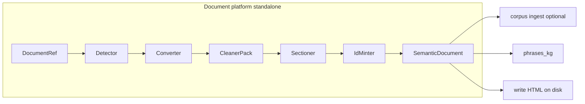
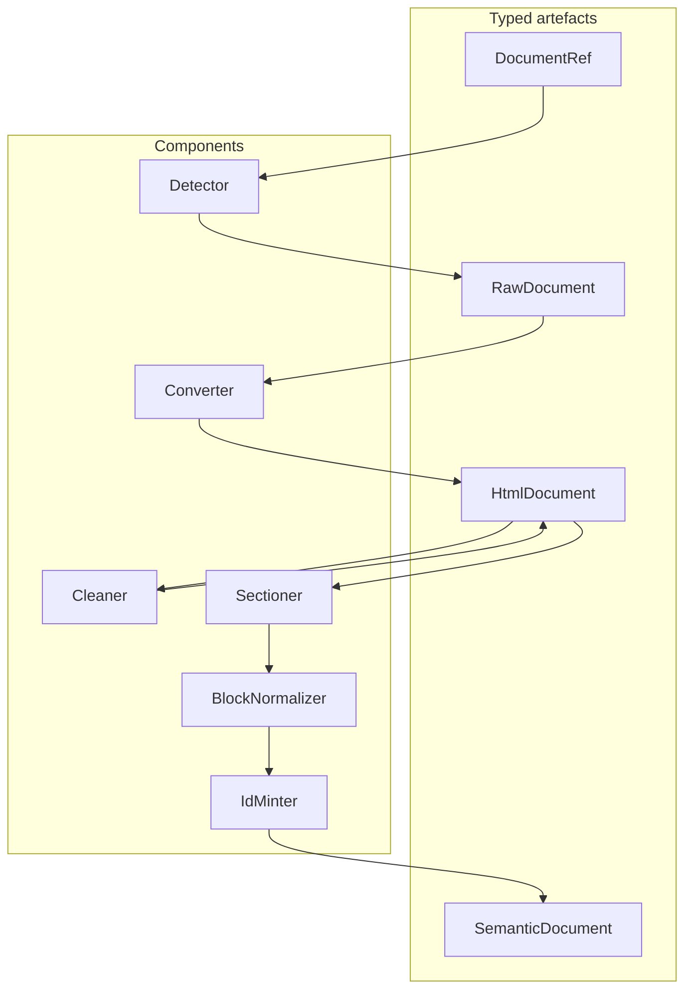

# Document platform — standalone semantifier / sectioner

**Date:** 2026-11-20  
**Owner:** `corpus/` (definitions + typed components; usable **without** BagIt ingest)  
**Prompt:** [discussions/prompt_2026-11-20_document_platform.md](../../../discussions/prompt_2026-11-20_document_platform.md)  
**Related:** [definitions_text_block.md](definitions_text_block.md) · [types_io_storage.md](types_io_storage.md) · [stream_tools.md](stream_tools.md) · [input_adapters.md](input_adapters.md) · [submodule_guidelines.md](submodule_guidelines.md) · [design.md](../../../docs/modules/corpus/design.md) · legacy [`transformation/`](../../transformation/)

**Intent:** import and semantify documents **independently** of corpus ingest. BagIt ingest becomes one *consumer* of the platform, not the only entry point. Think **typed components on a small platform**, not a full dataflow engine (Airflow/Prefect/Luigi are overkill for personal corpora and ECR laptops).

---

## 1. Why standalone

| Need | Without a platform | With a platform |
|------|--------------------|-----------------|
| Semantify a folder of XML/PDF/HTML | Forced through BagIt + review table | `documents → semantic HTML` only |
| Improve cleaner packs | Tangled with ingest/resume | Re-run sectioner/semantifier on the same files |
| `phrases_kg` on flat docs | Duplicate conversion logic | Reuse the same typed outputs |
| JOSS / demos | “Must install whole corpus story” | Thin CLI: convert + section + write HTML |

Corpus **ingest** still owns bags, IDs-as-membership, review CRUD. The **document platform** owns: detect → convert → clean → section → mint `text_block` ids → emit semantic HTML (+ optional sidecar index).



---

## 2. Platform shape (typed components, not a DAG product)

Keep orchestration **boring**: a fixed stage list + skip-satisfied stamps, or a tiny hand-written runner. Do **not** require users to author Airflow graphs.

### 2.1 Core types (owned by `corpus/`)

| Type | Meaning |
|------|---------|
| `DocumentRef` | Path or URI + optional `paper_id` hint + media type hint |
| `RawDocument` | Bytes or path + detected `format` (`jats_xml`, `pdf`, `docx`, `html`, `markdown`, …) |
| `HtmlDocument` | Well-formed HTML string/tree after conversion (may still be messy) |
| `SemanticDocument` | HTML with sections + [`text_block`](definitions_text_block.md) elements and stable ids |
| `Section` | Ordered region with `section_id`, title, child block ids |
| `TextBlock` | Leaf unit (`kind`, `id`, `text`, `parent_id`, `order`) |
| `CleanerPack` | Declarative rules (YAML/XPath/regex) + version id |
| `RunParams` | Declared stage params for skip-satisfied reuse |
| `StageResult` | Outputs + param stamp + errors (fail loud, per document) |

### 2.2 Typed components (plugins with stable interfaces)

| Component | In → Out | Role |
|-----------|----------|------|
| **Detector** | `DocumentRef` → `RawDocument` | Sniff format; reject empty/garbage |
| **Converter** | `RawDocument` → `HtmlDocument` | PDF/DOCX/JATS→HTML (Docling, existing `xml_to_html`, …) |
| **Cleaner** | `HtmlDocument` + `CleanerPack` → `HtmlDocument` | CMS/PDF debris → predictable tags |
| **Sectioner** | `HtmlDocument` → tree of `Section` stubs | Headings / JATS `sec` / heuristics |
| **BlockNormalizer** | sectioned HTML → `TextBlock` nodes | Map `<p>`, captions, `li`, … to kinds |
| **IdMinter** | tree → `SemanticDocument` | Mint document-unique ids (`#p-014`, …) |
| **Writer** | `SemanticDocument` → paths | Write `.semantic.html` + optional JSON index |
| **CorpusIngestAdapter** *(optional)* | `SemanticDocument` → BagIt overlay | Only when user wants a bag |

Each component is a **pure-ish function** (paths in/out allowed) with:

- declared `input_types` / `output_types`  
- `params` recorded in the stamp  
- no Streamlit/`sys.argv` inside the component (CLI/GUI are launchers)



### 2.3 What we deliberately skip (dataflow overkill)

| Dataflow feature | Why not (for now) |
|------------------|-------------------|
| Distributed workers / queues | Personal corpora; single laptop |
| Dynamic user-authored DAGs | Fixed science pipeline is enough |
| Multi-tenant schedulers | No ops team |
| Heavy lineage DBs | Param stamps + git’d cleaner pack versions suffice |

Optional later: wire the same components into `doit` for corpus-scale resume—**reuse components**, do not make `doit` the only API.

---

## 3. Standalone CLI / library (launcher contract)

```text
semantic_corpus documents semantify --input ./papers --out ./semantic --pack jats_default
```

Library (GUI-safe):

```python
run_document_platform(
    inputs=["./papers"],
    cleaner_pack="jats_default",
    write_html=True,
    ingest_to_corpus=None,  # or path to bag
)
```

| Mode | Behaviour |
|------|-----------|
| **Standalone** | Write semantic HTML (+ optional block index JSON) beside or under `--out` |
| **Ingest** | Call `CorpusIngestAdapter` after success |
| **In-memory** | Return `list[SemanticDocument]` for `phrases_kg` without writing a bag |

---

## 4. Relation to existing code

| Today | Target |
|-------|--------|
| [`transformation/xml_to_html.py`](../../transformation/xml_to_html.py), `pdf_to_html.py` | **Converter** implementations |
| Cleaner packs (design §2.3) | **Cleaner** + versioned packs |
| Ad-hoc section walks in phrase/preview code | **Sectioner** + **BlockNormalizer** shared with everyone |
| BagIt + review table | **Consumer** via adapter |
| `phrases_kg` `input.kind: documents` | Prefer platform output (`SemanticDocument` / semantic HTML) over re-parsing raw XML ad hoc |

---

## 5. Declarative pilot sketch

```yaml
run_name: semantify_ipcc_sample
platform:
  input_path: samples/ipcc_pdf/
  output_path: temp/semantic_ipcc/
  cleaner_pack: docling_pdf_v1
  formats: [pdf, html]
  mint_ids: true
  write_block_index: true
  ingest_to_corpus: null    # or corpora/ipcc_bag
  limit_documents: 2
  reuse_existing: true
```

Skip-satisfied: per-file stamp hashes `(source mtime/hash, converter id, cleaner_pack version, sectioner version, id scheme)`.

---

## 6. Boundaries

| In platform | Out of platform |
|-------------|-----------------|
| Detect, convert, clean, section, mint `text_block` ids, write semantic HTML | Repository search/download (`repositories`) |
| Declarative cleaner packs | Review-table CRUD UI |
| Optional hand-off into BagIt | Chatbot UX |
| Typed component registry | Full workflow engine product |

---

## 7. Implementation order (suggested)

1. Freeze types: `DocumentRef`, `SemanticDocument`, `TextBlock`, `Section` (align with [definitions_text_block.md](definitions_text_block.md)).  
2. Wrap existing `transformation/*` as **Converter** components + one Writer.  
3. Extract **Sectioner** + **IdMinter** used by preview/phrases into the platform.  
4. CLI `documents semantify` with limit-N fixture demo.  
5. Adapter: write overlay into an existing bag without re-fetch.  
6. Point `phrases_kg` documents mode at semantic HTML from the platform.

---

## 8. One sentence

**Treat semantify/section as a small typed-component platform that turns documents into `SemanticDocument`s on their own; corpus ingest and phrases/KG are optional downstream consumers—not prerequisites.**
