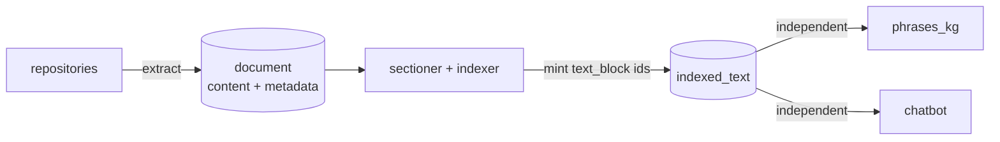

# Specification — `indexed_text` (intermediate)

**Date:** 2026-11-26  
**Owner:** `corpus/` (type registry; sole submodule input for text consumers)  
**Prompt:** [discussions/prompt_2026-11-26_indexed_text.md](../../../discussions/prompt_2026-11-26_indexed_text.md)  
**Related:** [definitions_text_block.md](definitions_text_block.md) · [types_io_storage.md](types_io_storage.md) · [input_adapters.md](input_adapters.md) · [siblings.md](../../../docs/modules/corpus/siblings.md) · [document_platform.md](document_platform.md)

**Intent:** name and pin the **shared intermediate** between extractors (`repositories`, `legacy`, …) and independent consumers (`phrases_kg`, `chatbot`, …).

**Code (generic component):** [`semantic_corpus/corpus/types/indexed_text.py`](../types/indexed_text.py) — `IndexedDocType`, `BlockKind`, field-name classes, `load_indexed_text(s)`, `blocks_of_kinds` / `iter_blocks`. Import via `semantic_corpus.corpus.types`.

**JSON Schema:** [`schemas/indexed_text.schema.json`](../schemas/indexed_text.schema.json)  
**Handoff (phrases_kg):** [`docs/modules/phrases_kg/indexed_text_handoff.md`](../../../docs/modules/phrases_kg/indexed_text_handoff.md)

---

## 1. Pipeline position



| Stage | Producer | Output | Role |
|-------|----------|--------|------|
| Extract | `repositories` (or `legacy` extractor, Zotero, …) | **`document`** — content bytes/text/HTML + bibliographic **metadata** | Not yet sectioned; may lack `text_block` ids |
| Section + index | document platform / sectioner (ids **included**) | **`indexed_text`** | This specification |
| Consume | `phrases_kg` | `term_set` / `knowledge_graph` | Uses blocks (+ metadata) |
| Consume | `chatbot` | RAG index / answers (out of scope here) | Uses blocks (+ metadata); **independent** of `phrases_kg` |

**`indexed_text` is the only required text product** downstream of sectioning. BagIt may *store* it; `legacy` may *emit* it; consumers must not depend on BagIt layout.

**Alias:** in older docs, `semantic_text` / `SemanticDocument` mean the same family. Prefer slug **`indexed_text`** for the consumer contract; keep `semantic_text` as a synonym in the type catalog until code fully migrates.

---

## 2. Definition

> **`indexed_text`** is one scholarly (or grey) document after sectioning: **stable `paper_id`**, **bibliographic metadata**, an ordered index of **[`text_block`](definitions_text_block.md)s with unique ids**, and optionally the **HTML** (or equivalent) that embeds those ids.

It is **not** raw repository download, not a hit list, not a knowledge graph, and not a chat transcript.

---

## 3. Normative fields

### 3.1 Required

| Field | Type | Meaning |
|-------|------|---------|
| `type` | string | Constant `"indexed_text"` |
| `paper_id` | string | Stable document id (corpus vocabulary; e.g. `europe_pmc_PMC7719169`) |
| `id_scheme` | string | Stamp for minting rules (e.g. `v1`); used by skip-satisfied |
| `blocks` | list[`text_block`] | Ordered leaf units; **non-empty** for a successful index |
| `metadata` | object | Bibliographic / provenance (§3.3); may be sparse but **must be present** (possibly `{}` only in fixtures) |

Each **`text_block`** (§[definitions](definitions_text_block.md)):

| Field | Required | Meaning |
|-------|----------|---------|
| `id` | yes | Unique within corpus scope; recommend `{paper_id}#{kind}-{local}` |
| `kind` | yes | e.g. `paragraph`, `heading`, `figcaption`, `listitem`, … |
| `text` | yes | Plain Unicode text of the block |
| `order` | yes | 1-based document order among indexed blocks |
| `parent_id` | no | Section or parent block id |
| `bbox` / coords | no | Optional layout; consumers must tolerate absence |

### 3.2 Strongly recommended

| Field | Type | Meaning |
|-------|------|---------|
| `html` | string | Indexed HTML with matching `id=` / `data-tb-kind` on block elements |
| `sections` | list | Optional section tree: `section_id`, `title?`, `child_ids[]` |
| `source` | object | How content was obtained (§3.4) |
| `warnings` | list[string] | Extractor/sectioner caveats (non-fatal) |

### 3.3 `metadata` (document-level)

Consumers use this for citation labels, filters, and display. Minimum useful set:

| Field | Required for pilots | Notes |
|-------|---------------------|-------|
| `title` | recommended | |
| `authors` | recommended | list or structured |
| `publication_date` | optional | ISO or year |
| `journal` / `publisher` | optional | |
| `doi` | optional | |
| `pmcid` / `pmid` / `handle` | optional | As available; do not invent |
| `license` | recommended when known | e.g. CC-BY |
| `language` | optional | BCP 47 |
| `abstract` | optional | Also may appear as blocks |
| `citation_label` | recommended for chatbot | Human-readable cite string |
| `repository` | optional | e.g. `europe_pmc`, `shodhganga` |
| `landing_url` | optional | |

Unknown keys are allowed under `metadata.extra` or as additional keys; producers should not delete consumer-unknown fields blindly.

### 3.4 `source` (provenance)

| Field | Meaning |
|-------|---------|
| `extractor` | e.g. `repositories`, `pymupdf`, `docling`, `amilib`, `html` |
| `content_format` | e.g. `jats_xml`, `pdf`, `html`, `markdown` |
| `content_path` / `uri` | Path or URI of the bytes that were sectioned |
| `metadata_path` | Sidecar metadata JSON if separate |
| `retrieved_at` | ISO datetime if from a repository |

---

## 4. JSON sketch (normative shape)

```json
{
  "type": "indexed_text",
  "paper_id": "europe_pmc_PMC7719169",
  "id_scheme": "v1",
  "metadata": {
    "title": "ClimateEU…",
    "doi": "10.1038/…",
    "pmcid": "PMC7719169",
    "license": "CC-BY-4.0",
    "citation_label": "Marchi et al. (2020)"
  },
  "source": {
    "extractor": "repositories",
    "content_format": "jats_xml",
    "content_path": "data/…/fulltext.xml"
  },
  "sections": [
    {"section_id": "sec-1", "title": "Introduction", "child_ids": ["europe_pmc_PMC7719169#p-001"]}
  ],
  "blocks": [
    {
      "id": "europe_pmc_PMC7719169#p-001",
      "kind": "paragraph",
      "text": "…",
      "order": 1,
      "parent_id": "sec-1"
    }
  ],
  "html": "<html>…<p id=\"europe_pmc_PMC7719169#p-001\" data-tb-kind=\"paragraph\">…</p>…</html>",
  "warnings": []
}
```

**On-disk (Store / BagIt overlay, suggested):**

| Artefact | Role |
|----------|------|
| `{paper_id}.indexed.json` | Canonical machine form (fields above; `html` may be omitted if large) |
| `{paper_id}.indexed.html` | HTML with ids (if `html` not inlined) |
| existing `metadata.json` | May be merged into `metadata` at index time |

---

## 5. Upstream: `document` (pre-index)

Not this spec’s payload, but the **input** to the sectioner:

| Field | Meaning |
|-------|---------|
| `paper_id` | Same id that will appear on `indexed_text` |
| `content` | `raw_bytes` / `raw_text` / `html_document` |
| `metadata` | `metadata_record` from `repositories` (or equivalent) |

`repositories` **extracts** to this document stage (content + metadata into a Store). **Sectioner + id minting** convert it to `indexed_text`. Extractors must not mint consumer `text_block` ids themselves unless they *are* the sectioner.

---

## 6. Consumer contracts

### 6.1 Shared rules

1. Prefer **`blocks[]`** as the unit of iteration; do not re-chunk arbitrarily if ids exist.  
2. Treat missing optional layout fields as normal.  
3. Preserve `paper_id` and block `id` in any derived edges, citations, or RAG chunk metadata.  
4. `phrases_kg` and `chatbot` **must not** require each other’s outputs.

### 6.2 `phrases_kg`

| Need | From `indexed_text` |
|------|---------------------|
| Phrase extraction text | `blocks[].text` (filter by `kind` / `document_unit`) |
| Component nodes | `blocks[].id` when `document_unit` is paragraph/`text_block`; else `paper_id` |
| Provenance | `paper_id`, `metadata`, `id_scheme` |

### 6.3 `chatbot`

| Need | From `indexed_text` |
|------|---------------------|
| Retrievable passages | `blocks[]` (or HTML sections); **prefer block ids over opaque RAG chunks** when available |
| Citation UI | `metadata.citation_label`, `doi`, `pmcid`, … |
| Fallback | If blocks empty, fail loud or fall back only with an explicit warning — do not silently invent structure |

**Migration note:** legacy [`chatbot_export_contract.md`](../../../docs/chatbot_export_contract.md) (manifest + XML paths) remains valid until exporters emit `indexed_text` streams; new work should target this spec.

---

## 7. Invariants

1. **Unique ids:** no duplicate `blocks[].id` within one `indexed_text`; recommend globally unique via `paper_id#…`.  
2. **Order:** `order` is dense increasing among listed blocks.  
3. **HTML consistency:** if both `html` and `blocks` are present, every block `id` should appear in HTML (warn if not).  
4. **Idempotence:** re-running sectioner with same `id_scheme` + same content should reproduce the same ids (skip-satisfied).  
5. **No KG / chat state** inside `indexed_text`.

---

## 8. Non-goals

- Embedding vectors (optional future sidecar; not part of `indexed_text`)  
- Term lists or graphs (`term_set`, `knowledge_graph`)  
- Review-table workflow (corpus membership; filters may *select* which `indexed_text` to emit)  
- Requiring online LLMs or network at consume time  

---

## 9. One sentence

**`indexed_text` is the sectioned, id-indexed document (text_blocks + metadata) that `repositories` (via sectioner) and `legacy` produce, and that `phrases_kg` and `chatbot` independently consume.**
