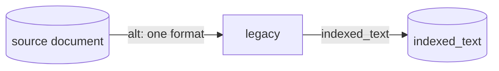
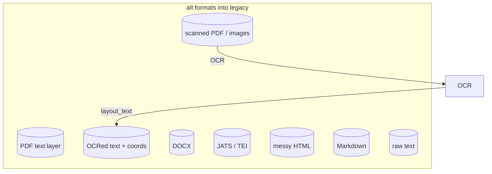

# Common input adapters → indexed semantic HTML

**Date:** 2026-11-23  
**Owner:** `corpus/` (stateless stream tools; shared by all submodules)  
**Prompt:** [discussions/prompt_2026-11-23_input_adapters.md](../../../discussions/prompt_2026-11-23_input_adapters.md)  
**Related:** [indexed_text.md](indexed_text.md) · [document_platform.md](document_platform.md) · [types_io_storage.md](types_io_storage.md) · [stream_tools.md](stream_tools.md) · [definitions_text_block.md](definitions_text_block.md) · [siblings.md](../../../docs/modules/corpus/siblings.md)

**Position:** Most submodules consume a stream of **indexed semantic HTML** (`semantic_text`: sections + id’d [`text_block`](definitions_text_block.md)s). When input is less structured, a **common, stateless input adapter** (one or more stages) converts common formats into that contract. Adapters do **not** require BagIt; they are stream tools ([stream_tools.md](stream_tools.md)).

---

## 1. Your list — and what was easy to miss

### 1.1 You named (keep)

| Input | Intent |
|-------|--------|
| PDF → text | Ignore images; **preserve coordinates** where the text layer allows |
| DOCX → HTML | Office prose → HTML |
| Raw text | No coordinates |
| OCRed text **with** coordinates | Layout-aware text (hOCR/ALTO-like) |

### 1.2 Important additions (STM / this repo)

| Input | Why |
|-------|-----|
| **JATS / PMC XML** | Already primary for EPMC; richest structure before HTML |
| **Messy / CMS HTML** | Gatsby, WordPress, publisher HTML — clean then index |
| **Markdown** | Notes, IPCC extracts, lab drafts |
| **Born-digital vs scanned PDF** | Text-layer PDF ≠ image-only PDF (latter needs OCR first) |
| **Partial HTML without ids** | Already “HTML” but not `semantic_text` — only IdMinter + sectioner |
| **TEI / GROBID XML** | Scholarly PDF pipelines often emit TEI, not JATS |
| **ODT / RTF** | Less common; pandoc covers if needed |
| **Page images (TIFF/PNG)** | OCR entry before “OCRed text with coords” |
| **EPUB** | Occasional books/reports |
| **Already `semantic_text`** | Identity / no-op adapter |

Optional later: PPTX, LaTeX, email/EML — only if a submodule demands them.

**Notation:** cylinder = **data**; rectangle = **process**. Arrow titles = types. **`alt`** = exactly one; **`and`** = both required.

**`legacy`** is the **converter** (**extractor** + **sectioner**). It is not a container. Its **single output** is **`indexed_text`** (same as `semantic_text` / indexed HTML + `text_block`s + metadata). Page coordinates may be attached optionally inside that artefact; downstream modules should not depend on them being present.

**Main flow:**



**Input formats to `legacy`** — **alternatives** (`alt`), not parallel inputs:



---

## 2. Proposed adapter: extractor + sectioner (stateless)

| Step | Name | In → Out | Job |
|------|------|----------|-----|
| 1 | **extractor** | bytes or path → `raw_text` \| `layout_text` \| `html_document` | Pull text/markup from the source format; keep coords when present |
| 2 | **sectioner** | those → **`indexed_text`** / `semantic_text` | Section, map to `text_block` kinds, **mint ids** (ids are part of sectioner) |

Optional OCR pre-step: `page_image` / scanned PDF → OCRed `layout_text`, then sectioner.

**Stateless:** same inputs + params → same outputs; no BagIt; no review table. Checkpoint via filestore streams if desired.

### 2.1 Intermediate types (extend the ladder)

| Type | Meaning |
|------|---------|
| `layout_text` | Text plus optional **bboxes** / page / line / word geometry (PDF text layer or OCR) |
| `raw_text` | Plain string; no geometry |
| `html_document` | Parseable HTML; may lack stable block ids |
| `semantic_text` | Indexed semantic HTML + `text_block` index (**submodule input**) |

### 2.2 Sectioner when input is not indexed

The **sectioner** owns structure **and** id minting (document-local, stable for fixed input + `id_scheme` version):

1. Detect blocks: `<p>`, captions, `<li>`, headings; or split `raw_text` / `layout_text` on blank lines / line clusters.  
2. Assign `kind` ([definitions](definitions_text_block.md)).  
3. Mint ids: `{paper_id}#{kind}-{n:03d}` (or hash of normalized text + order if no `paper_id`).  
4. Optionally attach `bbox` / `page` from `layout_text` as **annotation** on the block (not required for all consumers).  
5. Emit HTML with `id=` on elements + JSON block index → **`indexed_text`**.

Do **not** invent a second chunk vocabulary — always `text_block`.

### 2.3 Stream tool face

```text
semantic_corpus tool adapt-input \
  --in dir:./incoming \
  --out store:filestore:./work/streams/semantic \
  --lifetime temp \
  --params config/adapt_default.yaml
```

Library: `adapt_to_semantic_stream(items, params) -> Iterator[SemanticText]`.

---

## 3. Open libraries (map to extractor / sectioner)

### 3.1 Extractor — by format

| Format | Libraries (OSS) | Notes |
|--------|-----------------|-------|
| **PDF text + coords** | **PyMuPDF** (`fitz`), **pdfplumber**, pdfminer.six | PyMuPDF/pdfplumber strong for bboxes; ignore images by not rasterizing |
| **PDF → structured HTML/MD** | **Docling** (already in repo), Marker, MinerU | Heavier; good default when structure > raw coords |
| **Scholarly PDF → TEI/JATS** | **GROBID**, CERMINE | Best for refs/metadata; then sectioner on XML→HTML |
| **Scanned PDF / images → OCR+coords** | **ocrmypdf** + Tesseract; **PaddleOCR**; EasyOCR; output **hOCR** or **ALTO** | Then parse hOCR/ALTO → `layout_text` |
| **DOCX → HTML** | **mammoth**, **pandoc**, Docling, python-docx | mammoth/pandoc preferred for HTML fidelity |
| **JATS/XML → HTML** | Existing [`transformation/xml_to_html.py`](../../transformation/xml_to_html.py), lxml | First-class extractor path |
| **Messy HTML** | BeautifulSoup / lxml + declarative cleaner packs; trafilatura / readability-lxml for boilerplate | Cleaner packs already in corpus design |
| **Markdown → HTML** | Python-Markdown, mistune, pandoc | Then sectioner |
| **Raw text** | stdlib | Pass-through to sectioner splitters |

### 3.2 Sectioner — structure + ids

| Concern | Libraries / approach |
|---------|----------------------|
| HTML parse / rewrite | **lxml**, BeautifulSoup |
| Heading / section heuristics | Custom (JATS `sec`, `h1–h6`, font-size from layout); optional **sciwing**-class tools later |
| Block boundaries from layout | Cluster lines by y-gap / x-alignment (small custom code on pdfplumber/PyMuPDF dicts) |
| Id minting | **corpus IdMinter** (ours; part of sectioner) — not an external dependency |

### 3.3 Suggested default stack for this project

| Path | Default | Fallback |
|------|---------|----------|
| JATS/PMC XML | in-repo `xml_to_html` → sectioner | — |
| Born-digital PDF | Docling **or** pdfplumber/PyMuPDF → `layout_text` → sectioner | GROBID when bibliography quality matters |
| Scanned PDF | ocrmypdf/Tesseract → hOCR → sectioner | PaddleOCR if Tesseract quality fails |
| DOCX | mammoth → sectioner | pandoc |
| Raw / MD | light convert → sectioner | — |

Prefer **one sectioner** shared by all extractor outputs so ids and `text_block` kinds stay consistent.

---

## 4. Declarative pilot sketch

```yaml
run_name: adapt_mixed_demo
tool: adapt-input
stream:
  in: "dir:./samples/mixed"
  out: "store:filestore:./work/streams/semantic"
  lifetime: temp
  item_type_out: semantic_text
limit: 2
params:
  detect: auto
  steps: [extractor, sectioner]
  pdf:
    engine: pymupdf          # or docling | pdfplumber
    keep_images: false
    keep_coordinates: true
  docx:
    engine: mammoth
  ocr:
    engine: tesseract_hocr   # when PDF has no text layer
  sectioner:
    mint_ids: true           # ids included in sectioner
    id_scheme: v1
    kinds: [paragraph, figcaption, tablecaption, listitem, heading]
    attach_bbox_when_present: true
```

---

## 5. What submodules see

| Consumer | Expects |
|----------|---------|
| `phrases_kg`, encyclopedia, chatbot, … | Stream of **`indexed_text`** / `semantic_text` (indexed HTML + block index + metadata) |
| `legacy` (extractor + sectioner) | Hides PDF/DOCX/OCR/XML differences behind that type |

Coordinates are **optional annotations** on blocks; consumers that ignore layout still work.

---

## 6. Fixtures and tests

Small multi-format specimen under [`tests/resources/input_adapters/`](../../../tests/resources/input_adapters/):

- Markers for start/end page, recto/verso, headers/footers, floats, font emphasis, diacritics, Greek, Devanagari — see `SPECIMEN_MARKERS.md` (**prioritised omissions**: multi-column / footnotes / hyphenation critical; RTL/CJK and watermarks ignored; reading-order and crop-vs-media explained there).  
- Tests: [`tests/test_input_adapters_specimen.py`](../../../tests/test_input_adapters_specimen.py)  
- Sectioner helpers: [`corpus/converters/html_to_semantic.py`](../converters/html_to_semantic.py), [`raw_to_blocks.py`](../converters/raw_to_blocks.py)  
- Legacy pipeline: [`corpus/legacy/`](../legacy/) — tests [`tests/test_legacy_pipeline.py`](../../../tests/test_legacy_pipeline.py)  
- OA PDF↔HTML pair: [`oa_pdf_html_pair/`](../../../tests/resources/input_adapters/oa_pdf_html_pair/) (ClimateEU PMC7719169; PDF input, HTML ground truth)

---

## 7. Gaps to decide in weekly meeting

1. Is **coordinate preservation** required for v1 submodule demos, or only text+ids? (Recommendation: support in types; default engines may omit bbox until a consumer needs it.)  
2. Single PDF engine (Docling) vs dual (Docling for HTML structure + PyMuPDF for bbox)?  
3. Scanned-PDF OCR as required extra (`[ocr]`) so default install stays light.

---

## 8. Rich PDF/hOCR → HTML (beyond line dumps)

The ClimateEU compare example’s default PyMuPDF pane is only a **baseline** (characters as lines). Real scholarly conversion needs at least:

| Need | Typical OSS coverage (2025–26) | Notes |
|------|--------------------------------|-------|
| **Line joins** / de-hyphenation | Partial | pdftotext++, some Docling/Marker post-rules; still brittle |
| **Sub/superscript** | Partial | Docling optional script-position stage → `<sup>`/`<sub>`; often missing in plain extractors |
| **Headers / footers** | Partial | Docling `furniture` vs body; Marker strips; roles often fuzzy |
| **Footnotes** | Weak | Often dropped or merged into body; MinerU/pdftotext++/paperlayer claim better separation — evaluate, not solved |
| **Lists** | Partial | Docling/Marker/MinerU detect list items when layout is clear |
| **Fonts** (size/weight/style → roles) | Weak as *semantics* | Engines keep some style; mapping to glossary/heading **roles** is usually custom (**amilib** font-role path) |
| **Tables** | Stronger | Docling TableFormer; MinerU (incl. some multi-page); Marker; GROBID weaker alone |
| **Figures** + captions | Partial–good | Docling pictures+captions; Marker images; GROBID+layout masks improving |

**hOCR / OCR** inherits the same problems (line joins, furniture, footnotes, tables/figures) with worse typography cues; ALTO/hOCR give coords but not scholarly HTML structure.

**No single OSS stack is equivalent to a curated scholarly HTML pipeline.** Closest upstream extractors: **Docling** (already depended on), **Marker**, **MinerU**, **GROBID** (TEI for articles). For IPCC-style / font-role / page-join / id-rich HTML, **amilib** remains the practical place to extend; wrap Docling/MinerU as optional extractor backends, then amilib-style sectioner refinement into `indexed_text`.

### Implementation (`corpus/legacy/`)

| Piece | Module | Status |
|-------|--------|--------|
| Extractors | `legacy/extractors.py` | **pymupdf**, **docling**, **amilib** live; **marker** / **mineru** stubs |
| Sectioner | `legacy/sectioner.py` | id minting via `converters/html_to_semantic`; optional amilib `PageJoiner` when sibling `amilib/scripts` present |
| Pipeline | `legacy/pipeline.py` | `legacy_to_indexed_text(path, extractor=…, refine=…)` → `indexed_text` |
| Compare example | `examples/pdf_html_compare/build_compare.py` | uses pipeline; `--engine` / `--refine` |
| Extra | `pip install 'semantic_corpus[legacy]'` | amilib + pdfplumber + pymupdf |

## 9. One sentence

**A shared stateless `legacy` converter runs an extractor then a sectioner (ids included) to turn PDF/DOCX/XML/HTML/MD/raw/OCR into one stream of `indexed_text`.**
