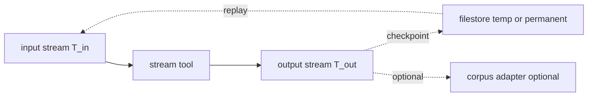
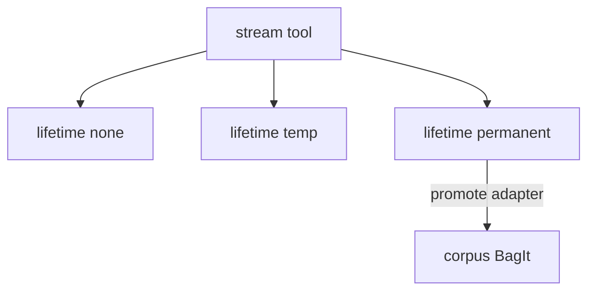
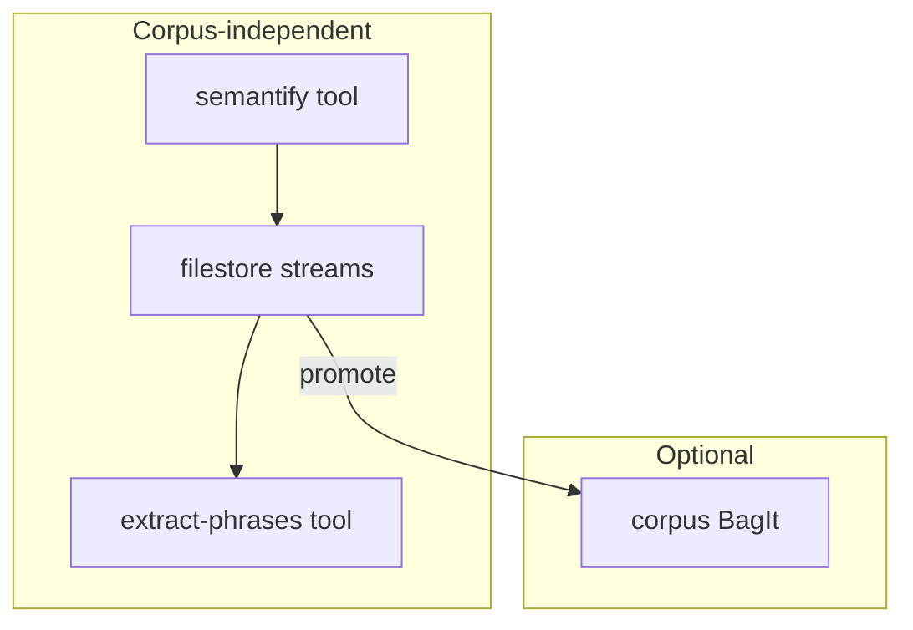

# Corpus-independent stream tools

**Date:** 2026-11-23  
**Owner:** `corpus/` (types + tool contract; tools themselves may live in any module)  
**Prompt:** [discussions/prompt_2026-11-23_stream_tools.md](../../../discussions/prompt_2026-11-23_stream_tools.md)  
**Related:** [types_io_storage.md](types_io_storage.md) · [document_platform.md](document_platform.md) · [submodule_guidelines.md](submodule_guidelines.md)

**Role:** a **stream tool** reads a **stream of typed objects**, transforms each (or a bounded window) into a **stream of typed objects**, and is **CLI-callable**. It does **not** require a BagIt corpus. Persistence is optional: streams may stay in-process, or be written to a **filestore** as temporary or permanent artefacts.

Corpus ingest, review UI, and BagIt membership are **downstream adapters**, not prerequisites.

---

## 1. Why this layer exists

| Without stream tools | With stream tools |
|----------------------|-------------------|
| Every transform assumes a bag path | Same convert/annotate logic runs on a folder, pipe, or bag |
| Hard to chain semantify → phrases without “open corpus” | Pipe or file-backed streams between CLIs |
| Temp demos pollute `corpora/` | Explicit temp vs permanent filestore roots |
| GUI/CLI reimplement loops | One `transform_stream` library API |

This is still **not** a dataflow engine: no distributed workers, no user-authored DAGs—just **typed stream in → typed stream out** plus optional filestore checkpoints.



---

## 2. Core concepts

### 2.1 Object stream

| Concept | Meaning |
|---------|---------|
| **Item** | One typed payload (`raw_text`, `semantic_text`, `term_set`, …) + identity (`paper_id` or run-local id) |
| **Stream** | Ordered sequence of items (iterator / JSONL / directory-as-stream) |
| **Schema** | Declared `item_type` slug from [types_io_storage.md](types_io_storage.md) |

A directory of files is a stream when each file maps to one item (e.g. one HTML → one `semantic_text`). A JSONL file is a stream of serialized items. An in-memory generator is a stream with no durable form.

### 2.2 Stream tool

| Property | Rule |
|----------|------|
| **Corpus-independent** | Must run with `storage.backend: filestore` or pure iterators; BagIt optional |
| **Typed** | Declares `input_item_type` → `output_item_type` (converter or annotator) |
| **Streaming-first** | Prefer one-in/one-out; document if a tool needs the full collection (e.g. corpus-wide TF-IDF) |
| **Library core** | `transform_stream(items, params) -> Iterator[item]` |
| **CLI facade** | Thin argv/YAML → open streams → call library → write/close |

**Collection-scoped exception:** some tools (global TF-IDF, bipartite clustering) need all items. They still accept a stream as *input source*, may buffer or materialize to filestore, then emit an output stream (or a single aggregate item such as one `knowledge_graph`). Mark these `stream_mode: collect` in metadata.

### 2.3 Tool kinds (aligned with converters / annotators)

| Kind | Stream contract | Example CLI |
|------|-----------------|-------------|
| **map-converter** | each `T_in` → one `T_out` | `raw_text` → `semantic_text` |
| **map-annotator** | each `T` → `T'` (+ sidecar) | attach section labels |
| **collect-builder** | stream `T_in` → one or few `T_out` | many `semantic_text` + `term_set` → `knowledge_graph` |
| **filter** | stream → subset | drop empty blocks |
| **tee / checkpoint** | pass-through + write filestore | save intermediate JSONL |

---

## 3. Filestore: temporary vs permanent streams

Streams are saved on the **local filestore** backend ([types_io_storage.md](types_io_storage.md) §5), not only held in RAM.

| Lifetime | Slug | Meaning | Typical path |
|----------|------|---------|--------------|
| **Ephemeral / none** | `none` | Iterator only; process end discards | — |
| **Temporary** | `temp` | Checkpoint for resume/debug; safe to delete; may live under `temp/` or system temp | `{filestore}/tmp/{run_id}/…` |
| **Permanent** | `permanent` | Kept as project artefact on filestore (still **not** a BagIt corpus unless promoted) | `{filestore}/streams/{name}/…` |

| Rule | Detail |
|------|--------|
| Default for exploratory CLI | `temp` for outputs unless `--permanent` / pilot says otherwise |
| Default for committed demos | `permanent` under a named filestore root **or** promote to `corpus` |
| `temp/` and large dumps | Do not commit to git `main` ([coding_style](../../../docs/coding_style.md) / branch strategy) |
| Promotion | Explicit tool or adapter: `filestore permanent` → `corpus` BagIt |



### 3.1 Stream serialization on filestore

| Format | Use |
|--------|-----|
| **JSONL** | One item per line (metadata + inline or path to payload) — best for CLI pipes and resume |
| **Directory** | One file per `paper_id` (HTML, JSON) — best for large `semantic_text` bodies |
| **Manifest** | `manifest.json` lists item ids, types, stamps, source stream id |

Recommended layout:

```text
{filestore}/
  streams/
    {stream_name}/
      manifest.json          # item_type, tool_id, params, lifetime
      items.jsonl            # or items/*.json + payloads/
      payloads/              # optional large bodies
  tmp/
    {run_id}/                # temporary streams; deletable
```

---

## 4. CLI contract

Every stream tool exposes the same shape (names may nest under `semantic_corpus <tool>`):

```text
semantic_corpus tool <name> \
  --in <stream-ref> \
  --out <stream-ref> \
  --config pilot.yaml \
  [--limit N] [--reuse-existing] [--lifetime temp|permanent|none]
```

| `--in` / `--out` ref | Meaning |
|----------------------|---------|
| `dir:./papers` | Directory-as-stream |
| `jsonl:./raw.jsonl` | JSONL stream |
| `store:filestore:./work/streams/raw_text` | Named filestore stream |
| `stdin:` / `stdout:` | Process pipe (JSONL) |
| `corpus:./corpora/demo` | Optional: read/write via corpus store adapter |

Examples:

```text
# Standalone semantify: dir → temp stream of semantic_text
semantic_corpus tool semantify \
  --in dir:./samples/xml_mini \
  --out store:filestore:./work/streams/semantic \
  --lifetime temp --limit 2

# Phrases from that stream → permanent term_set stream
semantic_corpus tool extract-phrases \
  --in store:filestore:./work/streams/semantic \
  --out store:filestore:./work/streams/terms \
  --lifetime permanent --config config/phrases_demo.yaml

# Optional: promote permanent filestore artefacts into a bag
semantic_corpus tool promote-to-corpus \
  --in store:filestore:./work/streams/semantic \
  --out corpus:./corpora/demo_bag
```

**Exit codes:** `0` success; non-zero on hard failure; partial success should write a run report and fail loud (item id + stage)—not silent skip without stamp.

---

## 5. Library API (GUI-safe)

```python
def transform_stream(
    tool_id: str,
    items: Iterable[TypedItem],
    params: dict,
) -> Iterator[TypedItem]:
    ...

def open_stream(ref: str) -> Iterable[TypedItem]:
    ...

def write_stream(
    ref: str,
    items: Iterable[TypedItem],
    *,
    lifetime: str = "temp",
) -> StreamManifest:
    ...
```

Streamlit/GUI calls these with the same `params` dict the CLI builds from YAML—no second implementation.

---

## 6. Relation to corpus and modules

| Layer | Role |
|-------|------|
| **Stream tool** | Corpus-independent transform; CLI + library |
| **Filestore stream** | Temp or permanent checkpoint of typed items |
| **Corpus (BagIt)** | Project membership, review table, JOSS artefact — via **promote** or tools that opt into `corpus:` refs |
| **Document platform** | Family of stream tools (`detect`, `convert`, `semantify`) |
| **`phrases_kg`** | Stream tools (`extract-phrases`, `build-kg`) reading `semantic_text` streams |
| **`repositories`** | Can emit a `hit_list` / `raw_bytes` stream into filestore before any bag exists |



---

## 7. Design rules (review verdicts)

1. **Yes — treat corpus-independent stream tools as first-class.** They are the default way to run converters/annotators outside BagIt.  
2. **Streams are the composition surface** (not Airflow graphs): CLI pipe, JSONL, or filestore stream refs.  
3. **Filestore holds stream checkpoints** with explicit `temp` vs `permanent`; corpus is a separate promotion step.  
4. **Prefer map tools**; mark collect tools clearly (TF-IDF, global KG).  
5. **One library loop**; CLI is only I/O and lifetime flags.  
6. **Do not** require opening a corpus to semantify a folder or to extract phrases from a semantic HTML stream.  
7. **Do** keep type slugs identical to [types_io_storage.md](types_io_storage.md) so promote-to-corpus stays trivial.

---

## 8. Pilot sketch

```yaml
run_name: stream_semantify_demo
tool: semantify
stream:
  in: "dir:./samples/xml_mini"
  out: "store:filestore:./work/streams/semantic"
  lifetime: temp          # temp | permanent | none
  item_type_in: raw_text
  item_type_out: semantic_text
limit: 2
reuse_existing: true
params:
  cleaner_pack: jats_default
```

---

## 9. Implementation order

1. Define `TypedItem`, `StreamManifest`, `open_stream` / `write_stream` on filestore.  
2. Wrap semantify as first map-converter stream tool + CLI.  
3. Add JSONL + directory stream codecs.  
4. Wire `extract-phrases` as stream tool consuming `semantic_text`.  
5. Add `promote-to-corpus` adapter.  
6. Document `stream_mode: map | collect` on each tool in module docs.

---

## 10. One sentence

**Corpus-independent tools consume a typed object stream and emit a typed object stream, are CLI-callable via a thin launcher, and may checkpoint that stream on filestore as temporary or permanent data—while BagIt corpus remains an optional promotion target, not the execution host.**
