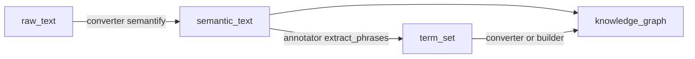
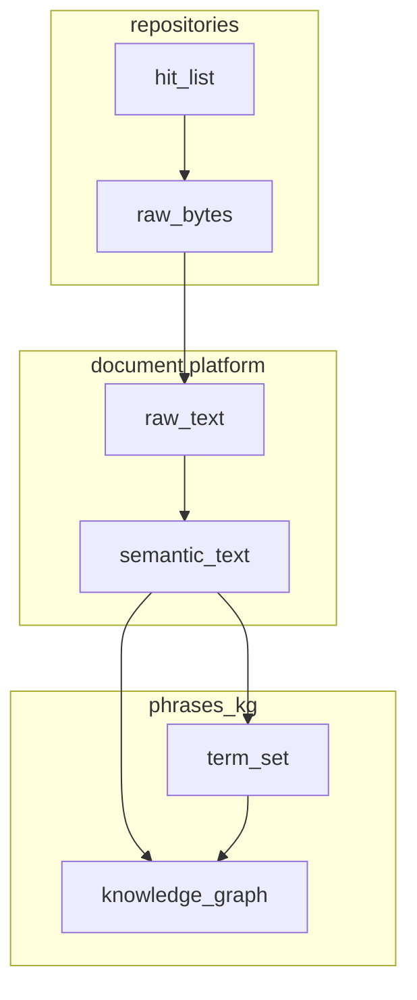
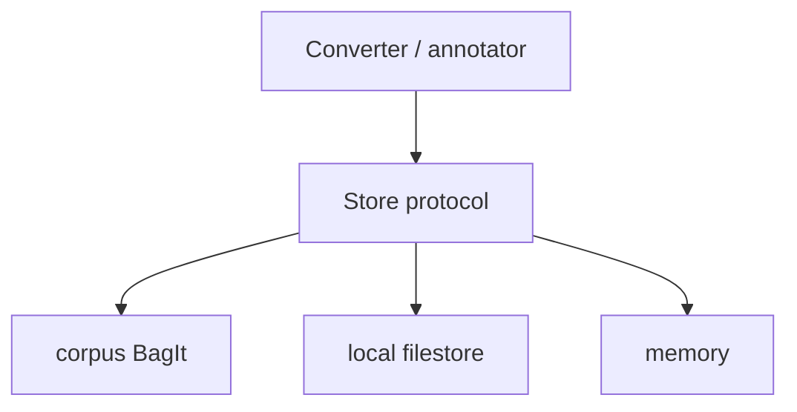

# Module I/O types, converters / annotators, and storage

**Date:** 2026-11-21  
**Owner:** `corpus/` (type registry for all modules)  
**Prompt:** [discussions/prompt_2026-11-21_types_io_storage.md](../../../discussions/prompt_2026-11-21_types_io_storage.md)  
**Related:** [definitions_text_block.md](definitions_text_block.md) · [document_platform.md](document_platform.md) · [stream_tools.md](stream_tools.md) · [submodule_guidelines.md](submodule_guidelines.md) · [phrases_kg controls](../../../docs/modules/phrases_kg/controls.md)

**Intent:** every module stage declares **typed inputs and outputs**. Transformations are either **converters** (change representation) or **annotators** (add layers without discarding the source type). Outputs land in a **`corpus` (BagIt)** or a **local filestore**, chosen per run—not hard-wired inside component code.

---

## 1. Converter vs annotator

| Kind | Contract | Example |
|------|----------|---------|
| **Converter** | `T_in → T_out` (new primary representation; may keep a pointer to source) | `raw_text` → `semantic_text` |
| **Annotator** | `(T, …) → T'` where `T'` is the same family plus overlays / sidecars | attach glossary hits on `semantic_text`; add Louvain labels on a `kg` |

Rules:

1. Converters and annotators are **library functions** in `*.py` (CLI/GUI only launch).  
2. Each declares `input_types`, `output_types`, and `params` for skip-satisfied stamps.  
3. They **read/write via a Store handle** (§5)—they do not embed “always BagIt” or “always ./out”.



---

## 2. Type catalog (owned by `corpus/`)

Names are stable slugs for YAML, Python, and stamps. Python classes live under a future `semantic_corpus.corpus.types` (or `…platform.types`); this doc is normative until code lands.

### 2.1 Document / text ladder

| Type slug | Meaning | Essential fields |
|-----------|---------|------------------|
| `document_ref` | Pointer only (path/URI + optional id hint) | `uri`/`path`, `paper_id?`, `media_type_hint?` |
| `raw_bytes` | Opaque file payload | `paper_id?`, `format`, `path` or `bytes` |
| `raw_text` | Plain or lightly structured text **without** corpus `text_block` ids | `paper_id?`, `text` or `path`, `format` (`plain`, `html_messy`, `markdown`, `jats_xml`, …) |
| `html_document` | Parseable HTML, not yet fully sectioned/id-minted | `paper_id?`, `html`, `path?` |
| `semantic_text` | Semantified document: sections + **`text_block`s with ids** | `paper_id`, `html` and/or block index, `blocks: list[text_block]`, `sections?`, `id_scheme` |
| **`indexed_text`** | **Consumer intermediate** (normative): same family as `semantic_text` + document **metadata** + provenance | See **[indexed_text.md](indexed_text.md)** — prefer this slug for `phrases_kg` / `chatbot` I/O |
| `text_block` | Leaf unit ([definition](definitions_text_block.md)) | `id`, `kind`, `text`, `parent_id?`, `order` |
| `section` | Ordered region | `section_id`, `title?`, `child_ids` |

**Your example:** `raw_text` → (semantifier/sectioner) → `semantic_text` / **`indexed_text`** (contains `text_block`s with IDs).

`SemanticDocument` in [document_platform.md](document_platform.md) **is** the document-scoped carrier of `semantic_text`. For submodule hand-off, use **`indexed_text`** ([spec](indexed_text.md)).

### 2.2 Bibliographic / corpus membership

| Type slug | Meaning |
|-----------|---------|
| `paper_id` | Stable document id string (one vocabulary) |
| `hit_record` | Search hit: id + metadata + landing URLs |
| `hit_list` | Ordered `hit_record`s from a query |
| `metadata_record` | Normalized bibliographic JSON for one paper |
| `review_row` | Review-table row vocabulary (include/exclude/…) |

### 2.3 Terms and graphs (`phrases_kg`)

| Type slug | Meaning |
|-----------|---------|
| `term` | One phrase/term: `display`, `normalized?`, `score?`, `source` (`extracted`\|`glossary`) |
| `term_set` | Collection of `term` (+ provenance / params) |
| `document_component_ref` | Pointer to a node used in KG: usually a `text_block.id` or whole `paper_id` |
| `kg_edge` | Typed edge: endpoints + `weight?` + `edge_type` |
| `knowledge_graph` | Nodes + edges + `graph_mode` (`bipartite`\|`term_term`) + optional clusters |
| `cluster_partition` | Communities / orphans over a `knowledge_graph` |

### 2.4 Run / config (not “content”, but typed)

| Type slug | Meaning |
|-----------|---------|
| `pilot_config` | Declarative YAML loaded to dict with schema id |
| `cleaner_pack` | Versioned declarative cleaner |
| `run_stamp` | Params + input hashes for skip-satisfied |
| `stage_result` | Outputs + errors + stamp for one stage/doc |

### 2.5 Explicit non-types (do not invent parallel names)

| Avoid as a parallel type | Use instead |
|--------------------------|-------------|
| Ad-hoc “chunk” | `text_block` |
| Module-private `pmcid` field in public APIs | `paper_id` (+ mapping at edges) |
| Embedding-only blob as default doc type | optional later `embedding_index`; not a substitute for `semantic_text` |

---

## 3. Module I/O matrix

### 3.1 Document platform (semantify / section) — often inside `corpus` package

| Stage | Kind | Input | Output |
|-------|------|-------|--------|
| Detect | converter | `document_ref` | `raw_bytes` / `raw_text` |
| Convert (XML/PDF/…) | converter | `raw_bytes` \| `raw_text` | `html_document` \| `raw_text` |
| Clean | annotator or converter | `html_document` + `cleaner_pack` | `html_document` |
| Section + mint ids | converter | `html_document` \| `raw_text` | **`semantic_text`** |
| Write | writer | `semantic_text` | paths in **Store** |

### 3.2 `corpus` ingest / review

| Stage | Kind | Input | Output |
|-------|------|-------|--------|
| Ingest hits/files | converter | `hit_list` \| `document_ref`s | bag membership + `raw_bytes` in store |
| Attach semantic overlay | annotator | bag + `semantic_text` | bag with overlay paths |
| Review | annotator | `review_row` updates | updated review table |

### 3.3 `repositories`

| Stage | Kind | Input | Output |
|-------|------|-------|--------|
| Search | converter | `pilot_config` | `hit_list` |
| Download | converter | `hit_record` | `raw_bytes` (+ `metadata_record`) |
| Hand-off | writer | hits/files | **Store** (`corpus` or local) |

### 3.4 `phrases_kg`

| Stage | Kind | Input | Output |
|-------|------|-------|--------|
| G1 extract | annotator / converter | `semantic_text` (preferred) or `raw_text` | `term_set` |
| G1 skip | — | glossary file → `term_set` | `term_set` |
| G2 build | converter | `term_set` + components from `semantic_text` | `knowledge_graph` |
| Cluster | annotator | `knowledge_graph` | `knowledge_graph` + `cluster_partition` |

Prefer **`semantic_text`** into G1/G2 so edges cite `text_block.id`. If only `raw_text` is available, platform should run first or G1 falls back to whole-document components (`document_unit: document`).

### 3.5 Bridges (encyclopedia / chatbot)

| Stage | Kind | Input | Output |
|-------|------|-------|--------|
| Encyclopedia label | annotator | `term_set` \| `knowledge_graph` | same + label sidecars |
| Chat export | converter | `semantic_text` / KG slices | export bundle type (TBD) |



---

## 4. Python layout (converters & annotators)

Target package layout (normative sketch; migrate legacy into these faces):

```text
semantic_corpus/corpus/
  types/                 # shared type slugs + light I/O (all submodules import here)
    indexed_text.py      # IndexedDocType, BlockKind, loaders (LIVE)
    text.py              # RawText, SemanticText, TextBlock, Section (future)
    graph.py             # Term, TermSet, KnowledgeGraph, ... (future)
    biblio.py            # HitRecord, MetadataRecord, ReviewRow (future)
  store/                 # Store protocol + corpus / filestore backends
    base.py
    corpus_bagit.py
    local_filestore.py
  converters/
    raw_to_html.py
    html_to_semantic.py  # section + text_block ids  → semantic_text
    ...
  annotators/
    phrase_extract.py    # may live in phrases_kg but typed against corpus.types
    ...
```

Submodules own domain converters/annotators but **import types + Store from `corpus`**:

| Module | Owns `*.py` | Uses types from |
|--------|-------------|-----------------|
| `corpus` | text ladder, store, semantify | itself |
| `repositories` | search/download converters | `hit_*`, `raw_bytes`, Store |
| `phrases_kg` | phrase + KG builders | `semantic_text`, `term_set`, `knowledge_graph` |

---

## 5. Storage options

Components receive a **`Store`** (protocol). Pilots set `storage.backend`.

### 5.1 Backends

| Backend | Slug | When to use | Layout sketch |
|---------|------|-------------|----------------|
| **Corpus (BagIt)** | `corpus` | Project artefact, JOSS demos, review UI, multi-stage resume | BagIt `data/documents/`, `data/indexes/`, metadata, review table |
| **Local filestore** | `filestore` | Standalone semantify; quick experiments; no membership/review | Root dir + conventional subfolders; no bag required |
| **Ephemeral** | `memory` | Tests / in-process pipelines | No durable write (optional) |



### 5.2 Store protocol (minimal)

| Method | Role |
|--------|------|
| `put(type_slug, paper_id, payload, role=…)` | Write artefact |
| `get(type_slug, paper_id, role=…) -> payload` | Read |
| `exists(…)` / `list(type_slug)` | Skip-satisfied + enumeration |
| `path_for(…)` | Optional filesystem path for tools that need files |

`role` distinguishes overlays: e.g. `raw`, `semantic_html`, `block_index`, `phrases`, `kg`.

### 5.3 Where each type usually lives

| Type | In `corpus` backend | In `filestore` backend |
|------|---------------------|-------------------------|
| `raw_bytes` / `raw_text` | `data/documents/{fmt}/` | `{root}/raw/{fmt}/` |
| `semantic_text` (HTML) | `data/documents/html/` or overlay dir | `{root}/semantic/{paper_id}.html` |
| `text_block` index | `data/indexes/blocks/{paper_id}.json` | `{root}/indexes/blocks/…` |
| `term_set` | `data/indexes/phrases/` | `{root}/indexes/phrases/` |
| `knowledge_graph` | `data/indexes/clusters/` or `kg/` | `{root}/indexes/kg/` |
| `review_row` | review table in bag | **not supported** (or thin optional CSV) |
| `hit_list` | query dir / packet under bag or `config` run folder | `{root}/runs/{run_name}/hits.json` |

### 5.4 Pilot controls (storage)

```yaml
storage:
  backend: corpus          # corpus | filestore | memory
  path: corpora/demo_bag   # bag root or filestore root
  reuse_existing: true
```

| Rule | Detail |
|------|--------|
| Default for series demos | `corpus` |
| Default for “semantify this folder” | `filestore` |
| `phrases_kg` | Accept either; prefer reading `semantic_text` from the same store the platform wrote |
| Never | Hard-code `corpora/` inside converter bodies |

### 5.5 Consistency rules

1. **One store per run** unless an explicit copy stage moves `filestore` → `corpus`.  
2. **Ids travel with payloads** — `paper_id` / `text_block.id` identical across backends.  
3. **Skip-satisfied** keys include `type_slug`, `role`, params hash, source hash—not backend name alone.  
4. Promoting filestore → corpus is a **converter/adapter**, not a silent side effect of semantify.

---

## 6. Example end-to-end typings

### A. Standalone semantify (filestore)

`document_ref` → `raw_text` → **`semantic_text`** → write under `filestore`.

### B. Repository → corpus → phrases

`pilot_config` → `hit_list` → `raw_bytes` (corpus) → `semantic_text` (corpus overlay) → `term_set` → `knowledge_graph`.

### C. Glossary-only KG on filestore semantic HTML

`semantic_text` (filestore) + glossary → `term_set` → `knowledge_graph` (`graph_mode: bipartite`), components = `text_block`s.

---

## 7. Implementation order

1. Add `corpus/types` dataclasses for `raw_text`, `semantic_text`, `text_block`, `term_set`, `knowledge_graph`.  
2. Add `Store` protocol + `LocalFilestore` + `CorpusBagItStore` (thin wrappers over today’s paths).  
3. Wrap `transformation/*` as converters emitting `semantic_text`.  
4. Point `phrases_kg` G1/G2 at `semantic_text` + Store.  
5. Schema-validate pilot `storage:` and stage type slugs in CI.

---

## 8. Stream tools (see dedicated note)

Converters/annotators are often exposed as **corpus-independent stream tools** (typed stream in → stream out, CLI-callable, checkpoint on filestore as temp or permanent). BagIt is optional promotion. Full design: [stream_tools.md](stream_tools.md).

---

## 9. One sentence

**Modules speak a shared type ladder (`raw_text` → `semantic_text` with id’d `text_block`s, then `term_set` / `knowledge_graph`); converters and annotators implement those edges in `*.py`; a pluggable Store puts artefacts in a BagIt `corpus` or a local filestore without changing component logic.**
